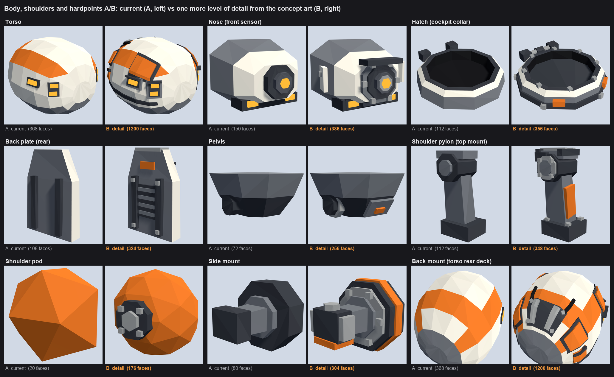
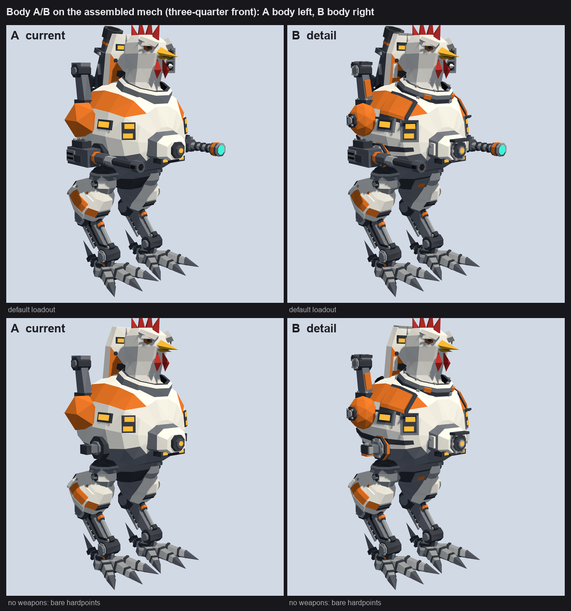
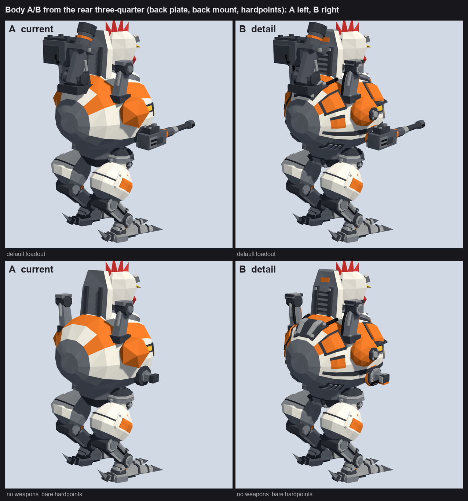

> **B adopted for all parts on 2026-11-22** (now `MechMeshes`, `assets/models/mech/<part>.res`); the `body_detail` lab
> subject, `BodyDetailMeshes`, `tests/test_body_detail.gd` and `tools/body_detail/` were removed. This folder is the
> record. The adopted mech: `adopted_three.png`, `adopted_front.png`, `adopted_side.png`, `adopted_walk.png`. One change
> on adoption: with the flipped legs the thigh pods swing up against the belly's lower rear quarters, so the rear belly
> grille moved from the two quarters to one panel on the centre line (torso 1100 faces instead of 1200) and the pelvis
> pistons moved in toward the centre line (x 0.1 / 0.075 instead of 0.2 / 0.16).

# Body, shoulders and hardpoints A/B: one more level of detail

This review does for the body parts what `docs/design/weapons-detail/` and `docs/design/legs-detail/` did for the weapons
and legs. **A** is each body part as the game has it now (`MechMeshes`, `assets/models/mech/<part>.res`). **B** is the
same part with one more level of detail taken from the concept art (`art/picks/mech_base.png`,
`art/picks/mech_loadout_full.png`, `art/renders/mech_r8/grid_mech_r8.png`). B is built by
`scripts/mech/body_detail_meshes.gd` (`BodyDetailMeshes`). Nothing in the game changes until a pick is made.

Each cell shows A (left) and B (right) from the same three-quarter camera. The back plate is seen from behind (its
grille side). The last cell is the torso's rear deck from behind and above, where the back-mount saddle sits (it is part
of the torso mesh).

Each mech image shows the chassis default loadout on top (laser, autocannon, rockets, mortar) and the same mech with no
weapons below, so the bare hardpoints are visible. In both, the left mech is the game's and the right mech has the B
meshes swapped onto its chassis nodes.

## What B adds

B starts with a copy of A's primitives, so the origin, orientation, size and palette stay the same. `LAYOUT`, `MOUNTS`,
`PYLON_TOP`, `SIDE_REACH` and `BODY_SCALE` are unchanged, so the weapons, head and legs fit without moving, and no
animation changes. B then adds chunky closed shells on top: plates laid on the torso's own facets, boxes, short 6- to
8-sided tubes and bolt heads, nothing thinner than about 2.5 cm. Faces built in ORANGE go to the "accent" surface, so B
takes the player's colour exactly as A does.

| Part | A faces | B faces | What B adds |
| --- | ---: | ---: | --- |
| Torso | 368 | 1200 | raised orange shoulder plates on dark under-plates (a panel line round each plate), a dark waist seam between the white flank and the grey belly, hooded light housings on grey surrounds, a vent grille on the rear belly, an orange unit plate on each rear flank, the back-mount saddle on the rear deck (dark pad, two steel rails, four bolts) and two cable runs from the back plate to it |
| Nose (front sensor) | 150 | 386 | a grey lens bezel with six bolts, a visor hood over the lens, a steel inner ring, dark frames round the amber lights, a two-slat chin grille, white cheek plates with a bolt each |
| Hatch (cockpit collar) | 112 | 356 | a dark band round the collar with five bolts, eight bolts on the rim, a hinge barrel with a knuckle between the hinge blocks, two orange tabs on the front |
| Back plate | 108 | 324 | a dark vent panel with four slats between the ribs, bolts at the rib ends, white edge plates on the front, a hood over the light, a round port opposite it, an orange tag high on the back, a steel top cap |
| Pelvis | 72 | 256 | grey skirt plates on the front and back slopes (an orange tag on the front one), steel axle collars, two hydraulic pistons down the back |
| Shoulder pylon (top mount) | 112 | 348 | four bolts on the base, an orange plate on the post, a steel hub ring with four bolts on the pivot, two mounting rails and two clamps on the top plate, an ammo feed stub, a cable up the post |
| Shoulder pod | 20 | 176 | a rounder pod (80 facets instead of 20, scaled back to A's bounds) with a dark pivot hub, a steel cap and four bolts on the outer face |
| Side mount | 80 | 304 | an orange band round the disc's rim, a steel step ring with six bolts, steel clamp jaws and a pivot pin on the mount block, an orange clamp plate under it, a cable from the disc to the block |

`tests/test_body_detail.gd` checks that every B part builds and has more faces than A, that B's bounds stay within 8 cm
of A's on every side and keep A's size, and that B keeps A's surfaces with the expected names. It also checks that the
shells B adds are closed (B has no more open edges than A), that the hatch rim still faces only up (the geometry audit's
check), and that the pylon top stays at `PYLON_TOP`, the side mount's block at `SIDE_REACH` and the saddle 2 to 9 cm
above the deck under `MOUNTS["back"]`. Finally it checks that the lab's assembled mode puts B on all eleven chassis
meshes and leaves A's mech alone.

### How well it reads at game distance

- **Clearly better:** the torso (the outlined shoulder plates, waist seam and hooded lights read on the whole mech), the
  shoulder pod (the hub gives it a joint, and the rounder facets come closer to the concept), the side mounts (the
  orange rim and step ring read even behind a weapon), the back plate's grille and orange tag, and the back-mount saddle
  when no mortar is fitted.
- **Good but partly hidden:** the shoulder pylon (the orange post plate and hub ring read, but the rails and clamps sit
  under the weapon when one is fitted), and the hatch (the band and bolts read, but the pilot's head covers the rim
  bolts and the hinge from most angles).
- **Weak / subtle:** the **pelvis**, which is almost hidden under the torso and between the hip sockets, so its skirts
  and pistons barely show on the assembled mech. The **nose**, whose bezel, hood and chin grille sit under the pilot's
  head and are best seen from low in front. The **torso's rear belly grille**, which only shows from low behind.
- **Over budget:** the torso has 3.3x A's faces (the facet-following plates need a row at every torso ring they cross).
  The pod and the pelvis are far above 3x because their A meshes are tiny (20 and 72 faces).

**Left out:** the concept's round screw heads, fine panel seams and hazard stripes. They would need sub-centimetre
geometry or textures, and the legs review showed that thin bands look stripey. Also left out: a bracket from the back
plate to the back mount. The back mount is half a metre behind the plate, so a bracket would break the plate's bounds.
The saddle on the torso's rear deck stands in for it.

## Viewing it

- In the lab: run `.\lab.ps1 body_detail` (subject **Body detail A/B (pick)**). Options:
  - `part`: one part, or `all`.
  - `show`: `both` (A beside B), `A` or `B`.
  - `view`: `parts` (turntables) or `assembled` (two MechModels, A body vs B body).
  - `loadout`: `default` or `bare` (the assembled view only).

  Params: turntable speed, gap between stands, labels.
- To re-render these images, run `.\tools\body_detail\shots.ps1`. It renders `tools/body_detail/shots.tscn` on the hidden
  desktop under the GPU lock, then composes the images with Python and Pillow (`tools/body_detail/make_ab_grid.py`). The
  raw shots and `faces.json` go to `test_logs\body_detail\`.

## Adopting B

Parts can be picked one at a time. For each picked part, the Mech session, which owns `scripts/mech/mech_meshes.gd` and
`assets/models/mech/`, does the following:

1. Move the builder body from `BodyDetailMeshes` into the matching `MechMeshes` builder, and drop the `MechMeshes.`
   prefixes. The builders map as follows:
   - `_torso`, `_nose`, `_hatch`, `_back_plate`, `_pelvis`, `_shoulder_pylon` and `_side_mount` go into the builders
     of the same name.
   - `_shoulder_pod` becomes a new `MechMeshes._shoulder_pod` with `POD_R`, replacing the inline `k.ico(...)` in
     `build()`.
   - The torso also needs `_torso_plate` and `_torso_box`.
2. Regenerate the meshes with `tools\models\gen_mech_meshes.ps1`.
3. Run `tests/test_mech_parts.gd` and `tests/test_geometry_audit.gd`. The hatch rim check is already guarded: B's rim
   bolts are sunk so the rim keeps its 20 up-facing faces.

Once a part is adopted, this review shows A = B for it. After the last pick, delete `BodyDetailMeshes`, the
`body_detail` lab subject (`scripts/mech/body_detail_lab.gd` and its line in `LabRegistry.SUBJECTS`),
`tests/test_body_detail.gd` and `tools/body_detail/`, and keep this folder as the record.
