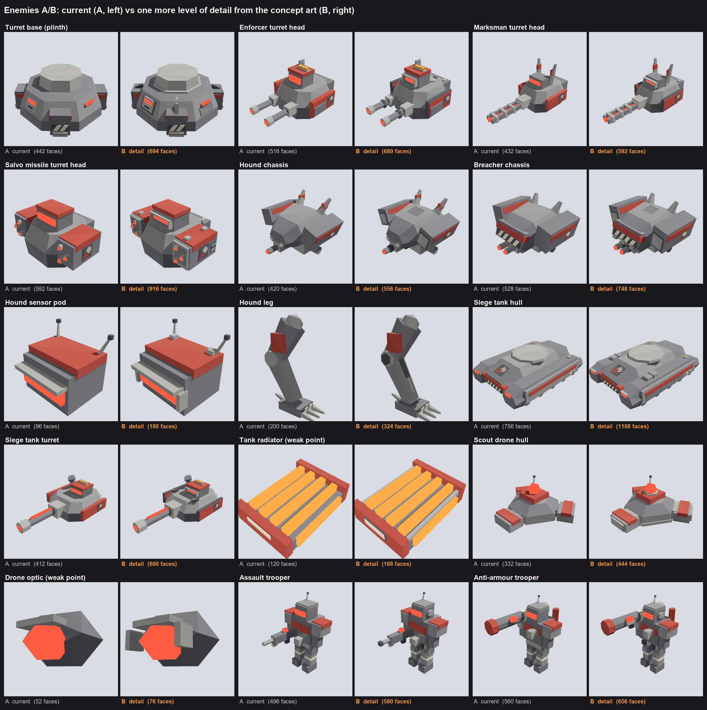
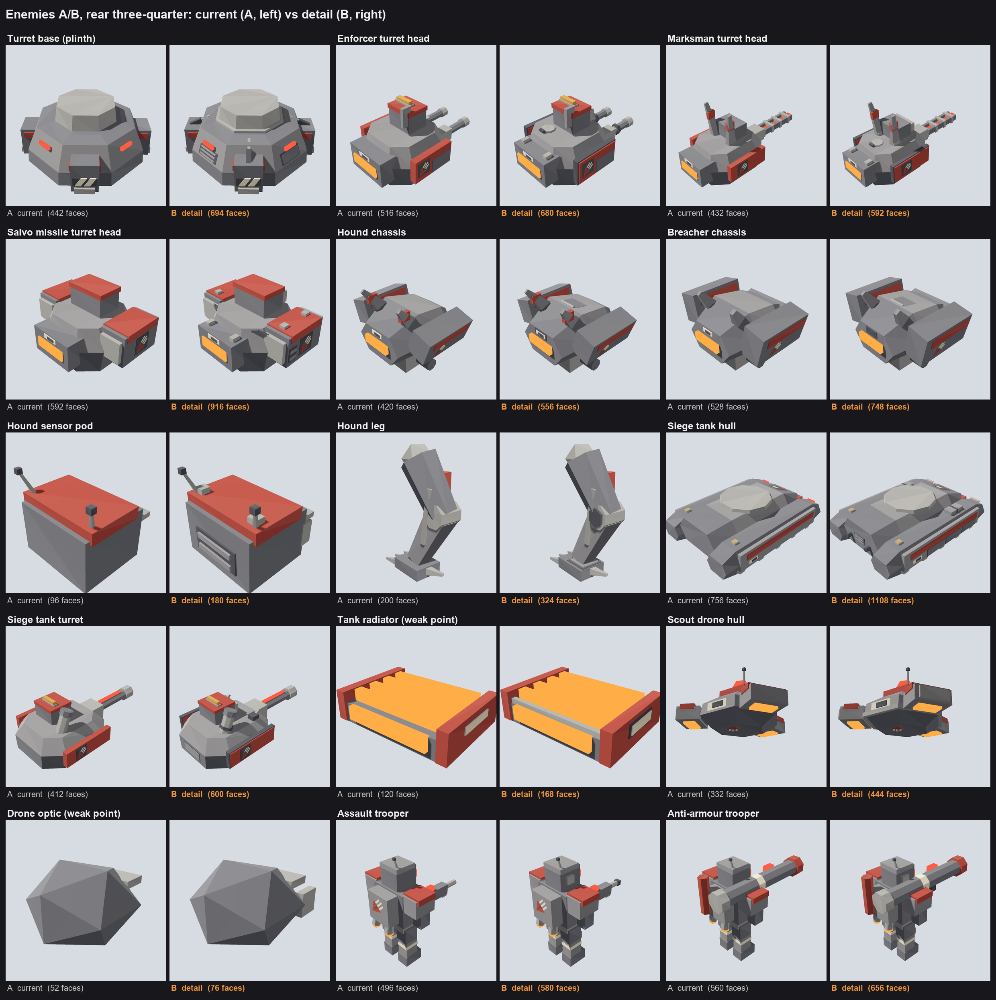
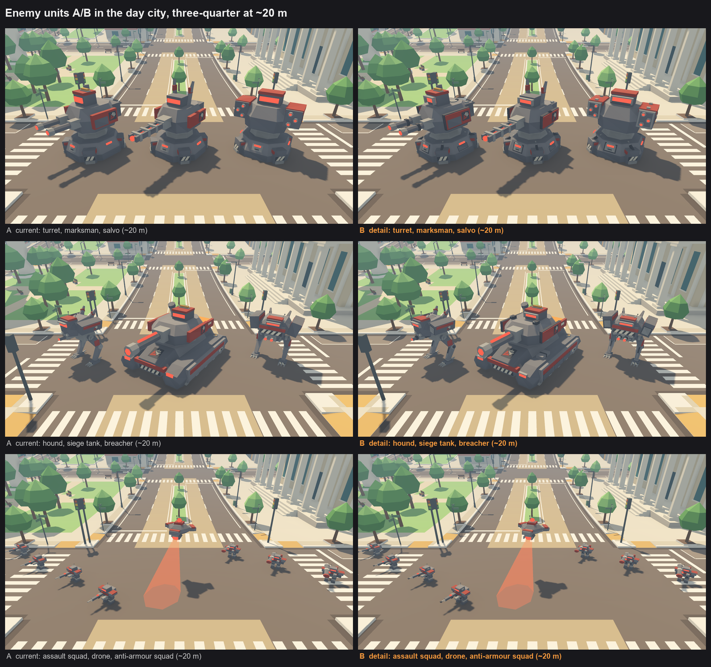
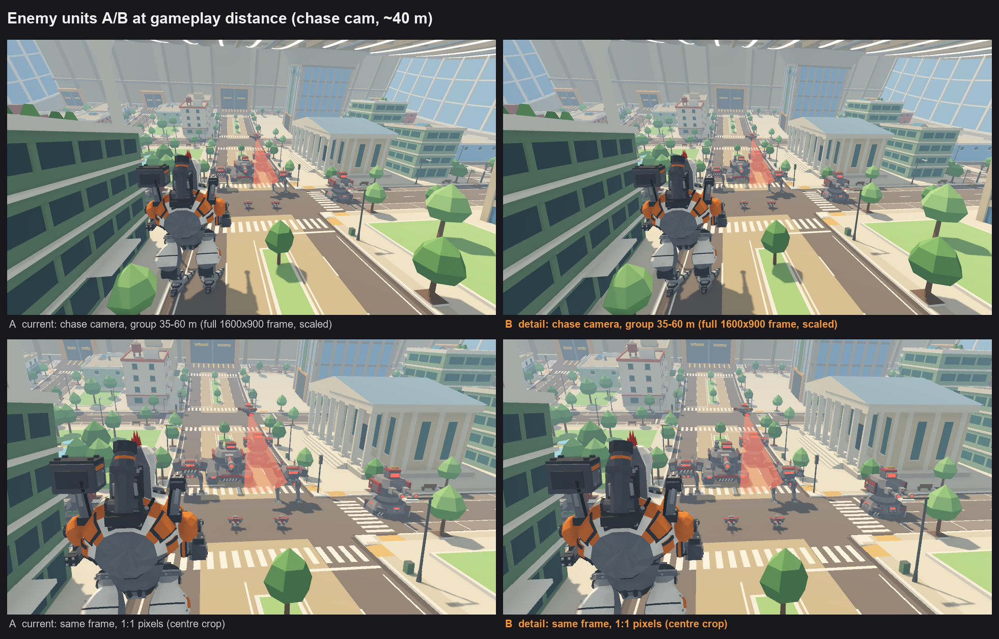
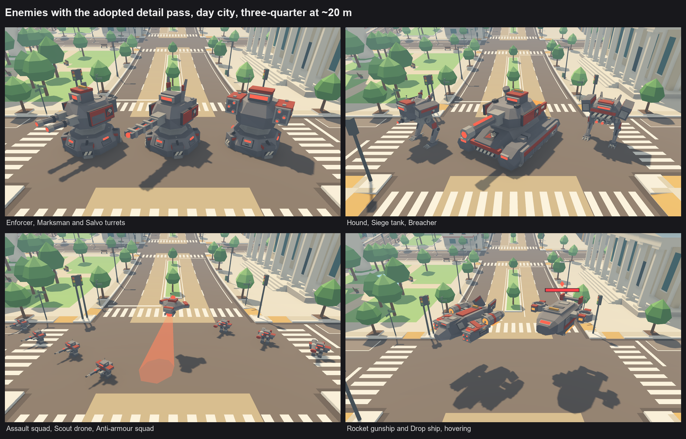
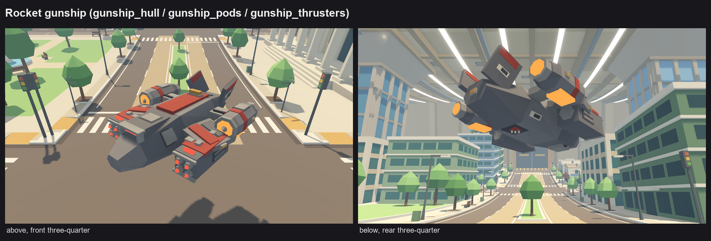
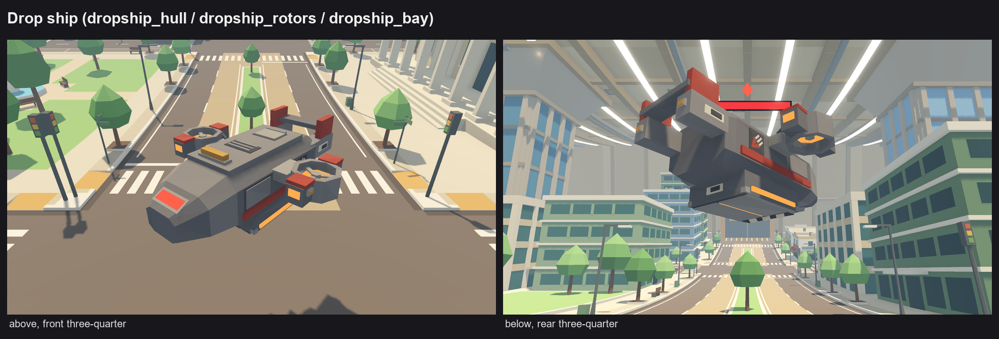
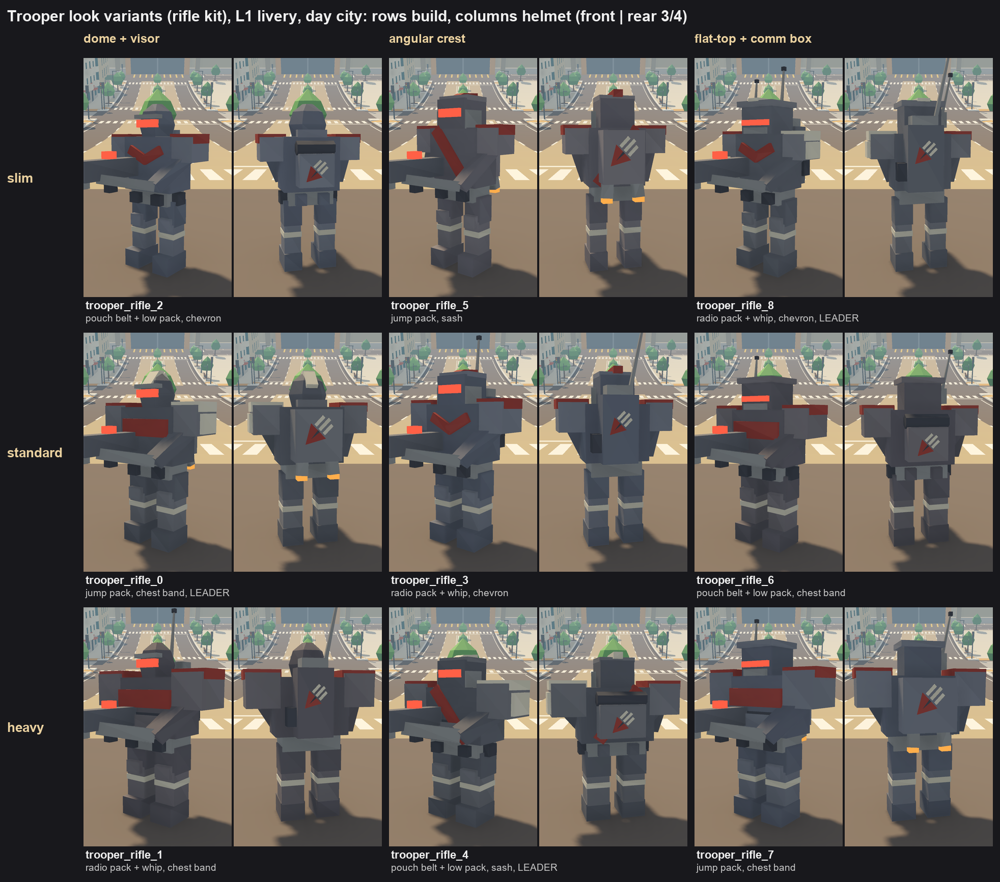
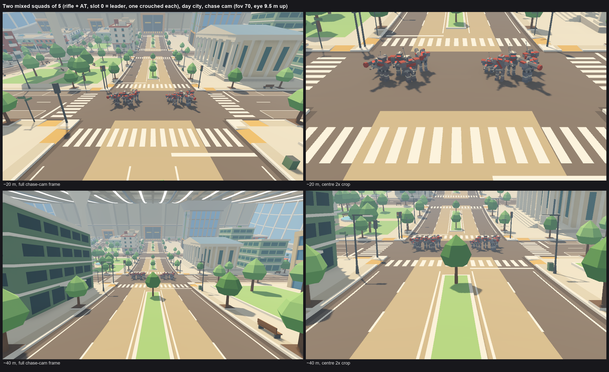

> **B adopted for all parts on 2026-11-22** (now `EnemyMeshes`, `scripts/enemy/enemy_meshes.gd`, troopers and drone
> included; the shared helpers `_panel` / `_vent` / `_piston` / `_hose` / `_optic_hood`, `_turret_head_detail` and
> `_strider_detail` moved with them). The adopted meshes were checked vertex-for-vertex against the B builders before
> `EnemyDetailMeshes` (`tools/enemy_detail/enemy_detail_meshes.gd`), its check and the A/B grid script were removed. This
> folder is the record: the A/B images below are the comparison as it was shown.
>
> Built at the same level the same day: the **rocket gunship** (`gunship_hull` / `gunship_pods` / `gunship_thrusters`) and
> the **drop ship** (`dropship_hull` / `dropship_rotors` / `dropship_bay`), to antigravity's contracts (thread
> `babamech-20261122-2000-enemy-art`); `EnemyGunship` / `EnemyDropDrone` switch from their placeholders to them on their
> own. The adopted roster: `adopted_lineup.png`, `adopted_gunship.png`, `adopted_dropship.png` (see "Adopted" at the end).
> `tools/enemy_detail/` now renders those from the live `EnemyMeshes` (`shots.ps1`) and checks every part headlessly
> (`check_meshes.gd`).

# Enemies A/B: one more level of detail

This review does for the enemies what `docs/design/body-detail/`, `legs-detail/` and `weapons-detail/` did for the player
mech. The user looked at the first enemy light pass (L1 slate / brick livery plus civic details, 2026-11-22) and asked to
bring the enemies up to the mech's detail-pass level. **A** is each enemy part as the game has it now (`EnemyMeshes`,
`scripts/enemy/enemy_meshes.gd`, after that light pass). **B** is the same part with one more level of detail taken from
the concept art (`art/renders/enemy_concept_r1/c1_repainted_civic_s4242.png`, the picked "repainted civic" concept, and
the r3 / r4 stills for the base machine shapes). B is built by `tools/enemy_detail/enemy_detail_meshes.gd`
(`EnemyDetailMeshes`). **Nothing in the game changes until a pick is made.**

Each cell shows A (left) and B (right) from the same close three-quarter camera on a neutral grey studio. Most of B's
rear-side additions (radiator lugs, vents, hatches behind the masts, exhausts) show better from behind:

Whole units, built by `EnemySpawner` exactly as the game builds them (AI idle), in the day-lit seeded city. The left
image has the game's meshes, the right one the same scene with every part swapped for its B mesh:

## What B adds

B starts with a copy of A's builder body, so the origin, pivot, orientation, size, palette (the L1 consts in
`EnemyMeshes`, no new colours), muzzle points and glow faces stay exactly the same. It then adds chunky closed shells:
plates laid on the part's own facets on a dark slate under-plate (a panel line round each), hooded optics, clamp collars,
hub caps, hinge barrels, hydraulic pistons, cable runs, vent panels with slats, lifting lugs and stowage boxes, nothing
thinner than about 2.5 cm. Like the mech passes it leaves out round screw heads, fine seams and thin hazard stripes; the
first pass's chunky hazard blocks (turret feet, tank bumper, breacher prow, hound toes) stay, and the one thin band, the
tank radiator's 4 cm "HOT" strip, is replaced by a cream warning plate on a slate backing.

| Part | A faces | B faces | B / original | What B adds |
| --- | ---: | ---: | ---: | --- |
| Turret base (plinth) | 442 | 694 | 2.53 | a slate frame and a hinge barrel on the hatch, a slatted vent on the rear flat, dark access plates on the side flats, a steel collar round the neck foot, an anchor ram (slate barrel, steel rod) from each foot up onto the plinth |
| Enforcer turret head | 516 | 680 | 2.00 | slate under-plates behind the brick cheek plates, a slate clamp collar on each barrel, a steel hood and side frames on the optic bar, a round commander hatch with a hinge block, two lifting lugs on the radiator |
| Marksman turret head | 432 | 592 | 2.11 | the cheek under-plates, hatch, lugs and optic hood as above, steel hinge blocks at the mast feet, a power cable under the rails |
| Salvo missile turret head | 592 | 916 | 2.08 | a raised steel frame round each pod's launch tubes, two lugs on each pod top, a slatted vent on each pod's outer face, a cable from each pod's rear block into the drum, radiator lugs, the optic hood |
| Hound chassis | 420 | 556 | 2.28 | a steel cap plate (slate rim) on each pauldron's front, a dark access hatch with a hinge barrel on the top slope, a slate frame round the rear unit plate, a barrel collar and an ammo box on the carbine |
| Breacher chassis | 528 | 748 | 2.20 | the shield cap plates, hatch and rear frame as above, three steel ram teeth under the prow, steel caps on the cannon drums, slate barrel collars |
| Hound sensor pod (weak point) | 96 | 180 | (1.88 x A) | steel side frames round the optic, a slatted vent on the back, steel collars at the whip feet |
| Hound leg | 200 | 324 | 2.13 | slate hub caps on both ends of the knee drum, a hydraulic cylinder down the front of the shin, a steel ankle hub, a raised plate on the foot top |
| Siege tank hull | 756 | 1108 | 2.11 | the skirt split into three raised slate-rimmed panels under the brick stripe, a stowage box with a strap on each sponson top, two crew hatches on the glacis above the stencil, steel hoods over the headlights, a rear vent panel between two exhaust stubs |
| Siege tank turret | 412 | 600 | 2.31 | slate under-plates behind the cheek plates, the optic hood on the cupola, a clamp collar on the barrel behind the charge rail, a collar on the mortar tube, a smoke-discharger block with a tube on each front corner of the roof, a stowage plate on the rear face |
| Tank radiator (weak point) | 120 | 168 | (1.40 x A) | A's thin "HOT" strip replaced by a cream warning plate on a slate backing, steel grille end bars before and behind the fins (fins and rear glow untouched) |
| Scout drone hull | 332 | 444 | 1.91 | a steel hinge block at each fin root, a steel end cap on each rotor pod, a steel collar round the beacon's foot, a steel step ring round the equator |
| Drone optic (weak point) | 52 | 76 | (1.46 x A) | steel side frames either side of the lens |
| Assault trooper | 496 | 580 | 1.61 | knee pads, two belt pouches, comm boxes on the helmet, a muzzle brake block |
| Anti-armour trooper | 560 | 656 | 1.52 | the same body additions, a sight bracket under the launcher optic, a grip block under the tube |

Not given a B: `turret_gun_wreck`, `tank_turret_wreck`, `debris_plate`, `debris_chunk`, `rupture_core` and the drone's
scanner `drone_cone` (charred / glowing / translucent: one more level of detail does not show on them). The gunship and
drop ship are not in `EnemyMeshes` yet.

**Budget** ("B / original" is against the pre-L1 meshes; the brief was about 2x on the big parts, troopers lean):

| | A tris | B tris | change |
| --- | ---: | ---: | ---: |
| turret (base + head) | 958 | 1374 | +416 |
| marksman turret | 874 | 1286 | +412 |
| salvo turret | 1034 | 1610 | +576 |
| hound (chassis, sensor, 2 legs) | 916 | 1384 | +468 |
| breacher | 1024 | 1576 | +552 |
| siege tank (hull, turret, radiator) | 1288 | 1876 | +588 |
| drone (hull, optic, cone) | 412 | 548 | +136 |
| assault squad (4 troopers) | 1984 | 2320 | +336 |
| anti-armour squad (4 troopers) | 2240 | 2624 | +384 |
| **solo deck** (hound, turret, tank, assault squad, marksman, drone, anti-armour squad) | **8672** | **11412** | **+2740 (x1.32)** |
| **4-player deck** (solo + breacher, salvo turret, tank, assault squad, drone, anti-armour squad) | **16654** | **21966** | **+5312 (x1.32)** |

Over the 2x target: the **turret base (2.53x)**, the **tank turret (2.31x)** and the **hound chassis (2.28x)**; the rest
are 1.9-2.2x. Even so a whole 4-player deck is about 22k enemy triangles, small next to the city. The troopers are the
part that multiplies (8 per solo deck, 16 per 4-player deck), so their B is held to +84 / +96 faces each.

## Checks

`tools/enemy_detail/check_detail.gd` (headless) runs the checks of `tests/test_geometry_audit.gd` on every B mesh
(no degenerate triangles, valid normals, winding matches the stored normal, watertight: 0 open edges; the turret base
and tank hull keep A's one buried open base, 8 and 10 edges, exactly as the audit allows), plus: B's bounds within 8 cm
of A's on every side, the glow surface identical to A's (same triangles, so the optic / vent / muzzle weak points do not
move), and no vertex colour outside the `EnemyMeshes` palette. **Result: PASS on all 21 parts.** Largest growth:
drone hull 5.7 cm (rotor-pod end caps), sensor pod 5.3 cm, tank turret 3.9 cm (rear stowage plate). Because nothing
moves more than 8 cm, the hit spheres in `EnemyCatalog` and the muzzle points in the unit scripts still fit.

## How well it reads at game distance

- **Reads at ~20 m (lineup):** the turret heads (the slate under-plates give the brick cheek plates a dark outline, the
  barrel collars and the salvo pods' steel tube frames read clearly), the tank (crew hatches, roof smoke blocks, mantlet
  collar and stowage boxes; the segmented skirt panels read well from the side), the hound / breacher pauldron and
  shield cap plates, the breacher's ram teeth, the turret plinth's neck collar and side plates.
- **Partly visible:** the hound's top hatch (only from above), the hound leg's shin cylinder and knee caps (a darker
  line on the shin), the turret plinth's anchor rams (read as dark wedges on the feet rather than as pistons), the
  radiator's warning plate.
- **Vanishes:** everything on the **troopers** (knee pads, pouches, comm boxes are a few pixels at 20 m), the **drone**
  additions (it flies 4-11 m up and is seen from below), the sensor pod's frames, the drone optic frames.
- **At gameplay distance (chase cam, 35-60 m):** honestly, A and B are hard to tell apart. The only differences you can
  pick out in the full frame are the darker outline round the turret cheek plates and a slightly busier tank. One more
  level of detail mostly pays off when a unit is close (a hound charging, a tank in the next street, a turret you are
  flanking on a roof), not at the distances where most fights start.

**Would leave out:** the trooper B (cost x16 per 4-player deck for nothing visible) and the drone B (vanishes from
below); if the budget matters, the turret plinth rams (+96 faces x every turret, read as wedges). The strongest picks
for what they cost: the three turret heads, the tank hull and turret, the hound / breacher chassis.

## Viewing it / re-rendering

At review time `tools/enemy_detail/shots.ps1` rendered these A/B images (studio parts at 900x900, city at 1600x900) and
composed them with Pillow. After adoption the A/B builder is gone; the same script now renders the adopted roster below.

## Adopting B (done 2026-11-22: all parts)

Every `EnemyDetailMeshes` builder body replaced the matching `EnemyMeshes._<part>` body (A's inline comments kept), with
the helpers `_panel`, `_vent`, `_piston`, `_hose`, `_optic_hood`, `_turret_head_detail`, `_strider_detail`. No unit script
changed: ids, origins, pivots, muzzle points, glow faces and hit layout are as before. `prewarm()` caches every part.

## Adopted: the roster, with the gunship and drop ship

The two aircraft are the habitat's civil-defence rescue VTOL and heavy lifter, repainted, built at the B level from the
start (same vocabulary: slate-rimmed plates, hatches with hinge barrels, hub caps, slatted vents, cables, unit plates,
amber service lamps, Descent stencils; closed shells, nothing under ~2.5 cm), inside antigravity's contracts:

| Part | Faces | What it is |
| --- | ---: | --- |
| `gunship_hull` | 724 | hexagonal fuselage, cockpit hump with the red visor under a steel hood and a roof hatch, brick spine with an amber light bar, swept stub wings (slate-rimmed top plates, brick leading edges, amber tip lamps), canted tail fins with brick tips and unit plates, crew doors, flank unit plates, chin searchlight turret, rear-top vent, amber tail lamp, one Descent stencil on the belly |
| `gunship_pods` | 560 | twin 2x2 rocket pods under the wing tips, muzzles at (+-1.9, -0.25, -2.1) with red warhead tips, steel tube frames, red sight lamp, lugs, outer vents, rear hub caps, pylons |
| `gunship_thrusters` (weak point) | 596 | twin round ducted-jet nacelles at (+-2.2, 0.45, 1.1): glowing intake fan behind a steel lip and spinner, glowing exhaust, glowing belly VTOL vent, brick band, top hatch plate, amber side lamp, pylon and cable |
| `dropship_hull` | 620 | rounded-box cabin with a sloped red windscreen in a steel frame, crew doors, a Descent stencil on each flank, brick flank bands, twin tail booms with brick fins, unit plates and amber tail lamps, tail bridge, rotor spar, roof hatch + hinge, roof vent, amber light bar, chin searchlight |
| `dropship_rotors` (weak point) | 600 | twin octagonal lift-fan ducts at (+-2.2, 0.55, 0) built from closed slabs round a glowing fan disc set at mid-depth (hub, three blades), fore/aft fairings with brick tops and glowing intake slits, amber lamp, strut and cable |
| `dropship_bay` | 244 | ventral bay: two steel door leaves on a slate seam that glows amber, chunky hazard band, hinge barrels, latch blocks, amber jump-light strips down both sides, unit plate. It keeps the placeholder's box (y -1.25..-0.58), so `EnemyDropDrone` sliding it down 0.35 m and the drop telegraph's orb at (0, -1.2, 0.1) still sit on the door |

Units: gunship 1880 faces, drop ship 1464 (tank 1876). Typical deck with the aircraft: solo (8 units incl. a gunship) 13292 faces, 4-player (16 units incl. 2 gunships and a drop ship) 27190. The drop ship's rotor span is 5.7 m like the placeholder (contract
says 5.2 m overall; the hit spheres at x +-2.2, r 1.25 need it).

Re-render: `.\tools\enemy_detail\shots.ps1` (headless `check_meshes.gd`, then the hidden-desktop city shots under the GPU
lock, then `make_adopted.py`). `check_meshes.gd` runs the geometry audit's checks on all 27 `EnemyMeshes` parts, checks
the palette and the aircraft contract boxes, and prints faces per part, unit and deck.

## Trooper look variants (2026-11-22, proposal for review)

A squad should read as distinct people, not four copies. Every trooper is now one of 12 look variants per kit, built in
`EnemyMeshes` (`scripts/enemy/enemy_meshes.gd`, section "Exo-troopers"), each a single closed-shell mesh cached by id:

- Part ids `trooper_<kit>_<n>`, kit `rifle` / `at`, n `0..TROOPER_VARIANTS-1` (12), through `mesh(part)` / `instance(part)`;
  `trooper_rifle` / `trooper_at` are variant 0 (same cached mesh). `EnemyMeshes.trooper_part(kit, look_seed)` maps any int
  to an id (`posmod`), `trooper_parts()` lists all 24, `trooper_id(part)` parses one, `trooper_look(n)` returns the choices.
  Optional: `trooper_squad_seeds(squad_seed, count)` gives slot 0 a leader variant and the other slots distinct
  non-leaders (162 distinct squads). All pure arithmetic and tables, no RNG: the same everywhere from the same spawn data.
- Axes per n: **build** slim / standard / heavy (torso and shoulder width, limb thickness, pauldron size; heavy adds a
  belly plate), **helmet** dome + visor / angular crest / flat-top with comm box and whip, **gear** jump pack with
  nozzles / tall radio pack with a 2.8 m whip / pouch belt + low pack with bedroll, **chest mark** brick band / chevron /
  sash, a **value shift** of the body and plate slate (+-5 %) with a slight cool or warm lean, **height** +-4 % (body only).
  n 0..8 are a Latin square (every build x helmet once, every gear once per row and column); 9..11 repeat the dome with
  a new gear. **Leaders** (n % 4 == 0: 0, 4, 8, one per build): cream left pauldron cap and outer plate, cream helmet
  stripe (cream crest on the crest helmet).
- Fixed per kit: weapon, hands, muzzle (rifle z -1.48, AT tube mouth z -1.52) and feet at the origin, so hit spheres,
  aim and the squad's crouch pivot work for every variant. Arms run shoulder (moves with build / height) -> elbow -> the
  kit's hand point.
- Faces: rifle 564-620, AT 596-652 (was 580 / 656). All 24 cost ~35 ms to build and are prewarmed.

The 3x3: rows build, columns helmet, each cell front and rear three-quarter (n 0..8). All 12: `trooper_variants_all.png`.

Two mixed squads of five (`trooper_squad_seeds(101)` and `(58)`) from the chase cam (fov 70, eye 9.5 m up) at 20 m and
40 m ground distance. At 20 m the silhouettes separate (whips, AT tubes, crest / flat tops, heavy vs slim shoulders,
leader cream). At 40 m a squad reads as a group of red-shouldered troopers; the per-person differences need the 2x crop
(a 4K screen or zoom). The brick pauldron trims dominate the read from above.

Re-render: `.\tools\enemy_detail\trooper_shots.ps1` (headless `check_meshes.gd`, hidden-desktop
`trooper_shots.tscn` under the GPU lock, `make_troopers.py`). `check_meshes.gd` covers all 24 variant ids (geometry
audit checks, palette incl. the variant tints, 450..680 faces, muzzle and height contract, id helpers).
