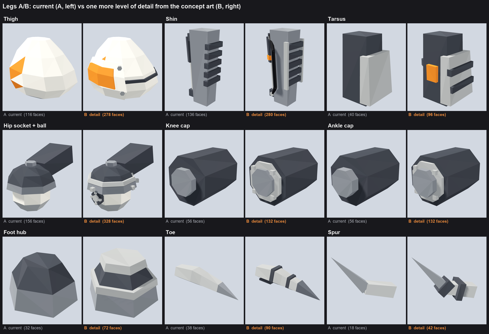
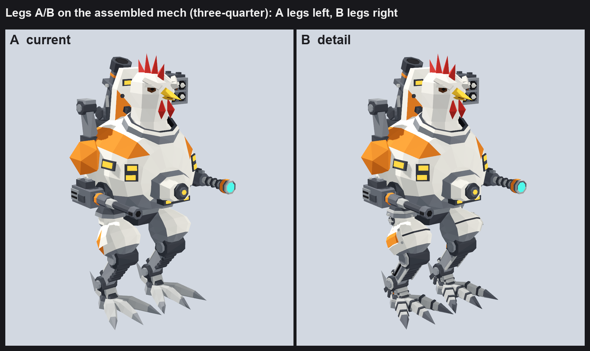
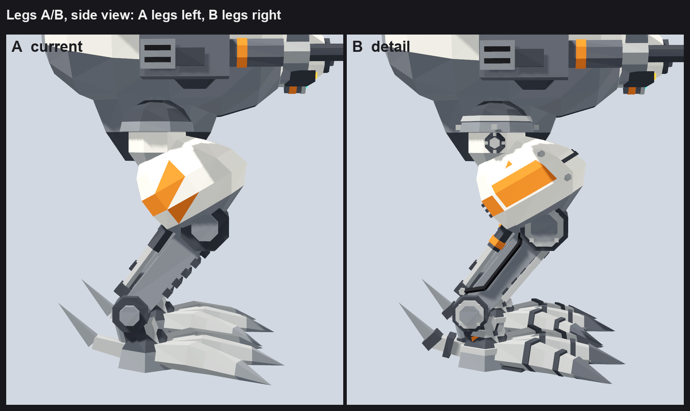

# Legs A/B: one more level of detail

**Adopted 2026-11-22: B for every leg part.** The B builders now live in `MechMeshes` (`scripts/mech/mech_meshes.gd`);
the A/B lab subject (`leg_detail`), `LegDetailMeshes`, `tests/test_leg_detail.gd` and `tools/leg_detail/` were removed.
The images below are kept as a record of the review.

This review does for the leg parts what `docs/design/weapons-detail/` did for the weapons. **A** is each leg part as the
game has it now (`MechMeshes`, `assets/models/mech/<part>.res`). **B** is the same part with one more level of detail
taken from the concept art (`art/picks/mech_base.png`, `art/picks/mech_loadout_full.png`,
`art/renders/mech_r8/grid_mech_r8.png`). B is built by `scripts/mech/leg_detail_meshes.gd` (`LegDetailMeshes`). Nothing
in the game changes until a pick is made.

Each cell shows A (left) and B (right) from the same close three-quarter camera, looking at the outer side of the right
leg. The hip socket is shown sitting over its ball, so that cell counts both meshes.

## What B adds

B starts with a copy of A's primitives, so the origin, the joint positions, REST_LENGTH and the palette all stay the
same, and the rig, IK and gait do not move. It then adds chunky closed shells on top: plates laid on the thigh pod's own
facets, boxes, short 6- to 8-sided tubes, bands and bolt heads. Nothing is thinner than about 2 cm. Faces built in
ORANGE go to the "accent" surface, so B takes the player's colour exactly as A does. B's thigh, shin and tarsus take every
Y position as a fraction of `MechMeshes.REST_LENGTH`, so the detail follows a length change (for example a longer
thigh).

| Part | A faces | B faces | What B adds |
| --- | ---: | ---: | --- |
| Thigh | 116 | 278 | stepped outer armour plate with an orange unit plate and two bolts, a raised panel line across the front, three rear vent slats |
| Shin | 136 | 280 | steel rails framing the ribbed tread, a hydraulic hose down the outer side, an orange band on the piston, clevis pins through the piston blocks |
| Tarsus | 40 | 96 | two tread ribs on the front plate, a clamp collar on the rear line, an orange unit tag on the outer side |
| Hip socket | 92 | 168 | a steel ring round the cup's shoulder and four bolts on its rim |
| Hip ball (`hip_cap`) | 64 | 160 | an outer hub on the ball: a dark disc, a steel cap and four bolts (concentric rings) |
| Knee cap | 56 | 132 | a concentric step ring on the outer end of the drum, with four bolts round the hub |
| Ankle cap | 56 | 132 | the same as the knee cap, scaled down |
| Foot hub | 32 | 72 | a steel collar on top of the hub and a steel band round its waist |
| Toe | 38 | 90 | two knuckle bands (three segments), a dark claw sheath on the tip, a dark pad under the first segment |
| Spur | 18 | 42 | a clamp block near the root and a dark collar at the bend |

B has 1.8x to 2.5x A's faces. `tests/test_leg_detail.gd` checks that B's bounds stay within 8 cm of A's on every side,
that the segments still span 0 to -REST_LENGTH, that the thigh top stays inside the hip ball and the foot parts stay on
the ground, that B keeps A's accent surface, and that every shell is closed.

**Left out:** the concept's round screw heads, fine panel seams and soft hydraulic hoses. They would need geometry below
1 cm or textures. On the hip socket, the strut into the pelvis is almost entirely buried in the pelvis, so it gets no
detail.

## Viewing it

- In the lab: run `.\lab.ps1` and pick the subject **Leg detail A/B (pick)** (`leg_detail`). Options:
  - `part`: one part, or `all`.
  - `show`: `A | B`, `A` or `B`.
  - `view`: `parts` (turntables) or `mech` (two assembled mechs, A legs vs B legs).

  Params: turntable speed, gap between stands, labels, and `gait` (walk cycles per second for the mech view).
- To re-render these images, run `.\tools\leg_detail\shots.ps1`. It renders `tools/leg_detail/shots.gd` on the hidden
  desktop under the GPU lock, then builds the images with Python and Pillow (`make_ab_grid.py`). The raw shots go to
  `test_logs\leg_detail\`.

## Adopting B

Parts can be picked one at a time. For each picked part, the Mech session, which owns `scripts/mech/mech_meshes.gd` and
`assets/models/mech/`, does three things:

1. Move the builder body from `LegDetailMeshes` into the matching `MechMeshes` builder (`_thigh`, `_shin`, `_tarsus`,
   `_hip_socket`, `_hip_ball`, `_cap`, `_foot`, `_toe`, `_spur`). The thigh also needs its helpers: `_thigh_spec`,
   `_thigh_at` and `_thigh_plate`. `_cap` serves both the knee and the ankle.
2. Regenerate the meshes with `tools\models\gen_mech_meshes.ps1`.
3. Run `tests/test_mech_parts.gd` and `tests/test_geometry_audit.gd`.

Once a part is adopted, this review shows A = B for it.
