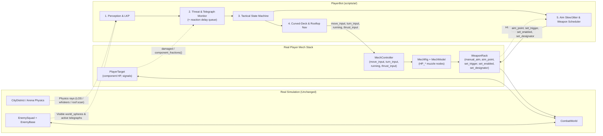

# Player AI Pilot & Automated Combat Balance Simulator

Status: **M1 + M2 + M3 implemented** (`PlayerBotSquad`, co-op scenarios, `EnemyLab` live `bot_*` spectator, `TestDriveBotPilot` helper ready for 1-line attach once `test_drive.gd` co-op lands), 2026-11-22. Parent: [enemies.md](enemies.md), [weapons.md](weapons.md), `AGENTS.md`.

## 1. Goal & Design Principles

We want a **fair, deterministic Player AI** (`PlayerBot`) that pilots a real player mech (`MechController` + `MechRig` + `WeaponRack` + `PlayerTarget`) through isolation duels, tactical pockets, and full `CityDistrict` clears so we can objectively measure:

- How well enemies defend themselves, coordinate, and punish sloppy play.
- Whether enemy HP, damage, projectile speed, telegraph durations, and attack slots feel lethal yet fair.
- Whether player weapons, heat dissipation, and limited ammo pools (Rocket Pod, future Missiles) remain balanced as numbers change.
- How solo vs. 2–4 player co-op scales before and after tuning passes.

### Core Invariants (Non-Negotiable)

1. **Strict Input-Only Fairness:** `PlayerBot` drives a real `MechController` and `WeaponRack` *exclusively* through the same control surface a human player uses (`move_input`, `turn_input`, `running`, `thrust_input`, `aim_point`, `set_trigger`, `set_enabled`; guided missiles follow `aim_point` automatically via `WeaponRack`). It never writes `global_position`, `velocity`, `heat`, enemy HP, or target transforms directly, and never calls combat verbs outside `WeaponRack` → `CombatWorld.fire`.
2. **Honest Perception:** The bot only perceives enemies through real physics LOS rays (`space.intersect_ray`), observable telegraph states (`ai_state == STATE_TELEGRAPH` with LOS, or mortar warning proximity), incoming hit events (`PlayerTarget.damaged`), and the HUD contract (`WeaponRack.slots()`, `WeaponRack.heat_state()`, `PlayerTarget.component_fractions()`). No wallhacks; behind cover it relies on its own decaying Last-Known Position (LKP) memory, just like a human.
3. **100% Deterministic:** Every bot owns a private `RandomNumberGenerator` seeded from `hash([mission_seed, bot_id, profile_id])`. Never uses global `randf()`/`randi()` (`AGENTS.md` rule 4, enforced by `tests/test_net_contract.gd`). Running the same scenario twice yields bit-identical telemetry.
4. **Co-op & Net-Contract Compliant:** Every gameplay script under `scripts/ai/` implements `net_fields()` classifying all script vars (`Net.SPAWN` / `Net.OWNER` / `Net.PRIVATE` / `Net.LOCAL`), uses zero network/Steam APIs, and fits the owner-authority model (offline or host-owned AI wingmen in future co-op).
5. **Headless-First & Fast:** The CLI balance suite runs headlessly (`--headless`), never acquires the shared GPU lock, and completes the default balance matrix in **< 15 s** via synchronous fixed-step simulation (`DT = 1.0 / 60.0`).

---

## 2. Fair Input-Only Architecture (`PlayerBot`)

### 2.1 Control Boundary (Human Parity)



- **Camera Parity:** In headless simulation, `WeaponRack.manual_aim = true` and `PlayerBot` drives `rack.aim_point` through an angular slew-limited virtual aim ray (matching `ChaseCamera` look-cone constraints: pitch clamped to `[-1.0, 0.55]` rad, horizontal turning feeds `MechController.turn_input = clampf(yaw_err * 4.0, -1.0, 1.0)` just like `TestDrive._physics_process` line 139!).
- **Spectator Camera Mode:** When `ChaseCamera` is attached (in `TestDrive --bot`), `PlayerBot` also rotates `cam.look_dir` and `cam.pitch` smoothly toward its virtual aim ray so the user watches through the mech's actual over-the-shoulder view.
- **Synchronous Stepping for Fast Sims:** Both `MechController` and `WeaponRack` expose `step(dt)`, `MechRig` exposes `update_pose(dt)`, and `CombatWorld` exposes `advance(dt)`. `PlayerBot` exposes `step(dt)` (called automatically by `_physics_process` when `auto_step = true`, or driven manually in a tight loop when `auto_step = false`).
  - In headless balance runs, after `await frames(2)` so `CityDistrict` static colliders register in `PhysicsServer3D`, the simulator sets `set_physics_process(false)` on `mech`, `rig`, `rack`, and `bot`, and advances each frame deterministically in exact gameplay order:
    1. `bot.step(DT)` (reads world, writes inputs)
    2. `mech.step(DT)` (integrates kinematics, `move_and_slide()`, heat, thrusters, landings)
    3. `rig.update_pose(DT)` (updates leg IK and `HP_*` muzzle world transforms)
    4. `rack.step(DT)` (checks blocked LOS, updates charge/spin/cooldowns, fires into `world`)
    5. `world.advance(DT)` (ticks `PlayerTarget` + `EnemyBase` + projectiles/impacts)

### 2.2 Human Imperfection Model (Why the Bot Isn't an Aimbot)

To accurately represent real players and avoid masking balance issues with superhuman reflexes, `PlayerBot` routes perception and aim through explicit human-error filters configured per `BotProfile`:

| Mechanism | How It Works | Purpose |
|---|---|---|
| **Reaction Delay Queue** | New enemy sightings, telegraph starts, and target switches enter a timestamped delay queue (`reaction_s ± reaction_jitter_s`). The bot cannot dodge a telegraph or snap to a flanker until the delay elapses. | Ensures `>= 0.3 s` telegraphs are genuinely tested at human reaction latencies (`0.18–0.45 s`). |
| **Aim Slew & Tracking Lag** | The bot maintains a persistent `virtual_aim_dir` that slews toward the desired aim direction at `aim_slew_deg_s`, plus low-pass smoothing on estimated target velocity (`vel_track_rate`). | Prevents instant 180° flicks; fast-orbiting Skirmishers challenge lower-skill profiles. |
| **Continuous Aim Drift (OU Noise)** | Instead of uncorrelated white noise per frame, angular aim error evolves as a seeded Ornstein–Uhlenbeck random walk (`aim_error_deg`, `aim_drift_hz`) around the desired aim point. | Mimics realistic hand/mouse tracking wobble — shots occasionally miss small weak points (`sensor` `r = 0.85 m`) without vibrating unnaturally. |
| **Ballistic Lead Skill** | For projectile weapons (`autocannon` 70 m/s, `gatling` 85 m/s, `rockets` 45 m/s, `mortar` arc), the bot computes target intercept using `lead_skill` (`0.0–0.95`) × estimated target velocity. | Rookies trail behind strafing Skirmishers; Veterans lead shots cleanly. |
| **Dodge Probability & Commitment** | When a visible telegraph finishes reaction delay, the bot rolls `dodge_chance` (seeded). On success it commits to a lateral strafe reversal (and optionally a short thruster hop if `hop_on_heavy` and heat allows) for `0.45–0.75 s`. | Mirrors how humans catch most telegraphs but mistime or tunnel-vision through some. |
| **Heat Hysteresis** | Tracks `rack.heat_state()["fraction"]`. Stops firing hot weapons above `heat_stop` (e.g. `0.84`) and resumes below `heat_resume` (e.g. `0.58`), leaving headroom for emergency thruster burns. Rookie sets `heat_stop = 1.05` (occasionally overheats!). | Tests whether heat caps and weapon heat costs create meaningful pacing vs. frustrating lockouts. |

### 2.3 Internal Decision Pipeline (`PlayerBot`)

1. **Perception (`_sense`):**
   - Scans `world.targets` for alive `team == "enemy"` units within `165 m`.
   - Performs physics LOS check from mech eye (`mech.global_position + up * 6.5`) to enemy core sphere.
   - Updates per-enemy memory `{enemy, last_pos, last_seen_t, has_los, est_vel, hp_ratio}`. Memory decays after `18 s` (or when cleared by squad intel).
   - Listens to `PlayerTarget.damaged` so being shot from behind triggers a turn-toward-threat alert after `reaction_s`.
2. **Threat & Telegraph Monitor (`_update_threats`):**
   - Inspects visible enemies in `EnemyBase.STATE_TELEGRAPH` (and active `enemy_mortar` flight threats via `CombatWorld.effects` within visual/audio warning range once launched, simulating the closing ground ring).
   - Queues dodge triggers with `reaction_s` latency.
   - Computes an immediate `dodge_vec` perpendicular to the incoming line of fire (or directly away from a mortar ring center) in the mech's local floor plane (`RingFrame.up_at`).
3. **Tactical State Machine (`ai_state`):**
   - `ADVANCE`: Navigate along `CityPlan.road_graph()` toward nearest unengaged/known enemy pocket (or patrol sector sweep if none spotted yet).
   - `ENGAGE`: Maintain archetype preferred engagement range (`preferred_range ± 10 m`), circle-strafe in local floor plane, manage aim & fire.
   - `DODGE`: High-priority timed override (`0.45–0.75 s`) reversing strafe direction + optional `running = true` or brief `thrust_input = true` hop when a Siege Cannon / Bolter telegraph locks or a mortar ring lands nearby.
   - `SEEK_HIGH_GROUND`: (Average occasionally, Veteran actively vs. `tank` or rooftop `turret`) Finds a reachable `CityPlan` standable roof (`band <= 1`, `roof_h <= 14 m`, within `28 m`) with sightline to target, approaches ledge, and executes a controlled thruster climb.
   - `TAKE_COVER`: (Veteran when `heat > 0.80` or core component HP `< 45%`, or while firing Back Mortar at a Siege Tank) Steps behind the nearest building corner to break LOS, cools down, and lobs indirect `mortar` fire at LKP.
   - `RECOVER_SHUTDOWN`: Mech is overheated (`mech.shutdown == true`): clears all triggers/inputs cleanly and waits for `rebooted`.
4. **Curved-Deck & Rooftop Navigation (`BotNavigator`):**
   - **Macro pathing:** Reuses `CityPlan.road_graph()` (via a shared lightweight A\* helper or `EnemySquad.find_arc_path`) in 2D arc `(x, s)` space, converting waypoints back through `RingFrame.arc_to_world`. Works identically on flat arenas (`ring == null`) and curved 300 m habitat decks (`ring != null`).
   - **Local steering & stuck escape:** 5-ray horizontal whisker fan at chest height (`up * 4.0`) + step-height probe (`up * 1.2`) to steer smoothly around street curbs, building corners, and pillar cores. Tracks 2-second displacement; if displaced `< 1.5 m` while intending to move, triggers a brief reverse + lateral sidestep or low thruster hop to unstick (and increments a `stuck_recoveries` diagnostic counter so navigation bugs never hide silently!).
   - **Rooftop climb maneuver:** When ascending a building tier of height `H <= 14 m`: approaches within `7 m` of the edge, holds `thrust_input = true` while moving forward until `height_above_roof >= 0.8 m` (aborting safely if `heat_fraction >= 0.78`), then clears the parapet and releases thrust (`MechController.auto_burn` handles safe drops automatically).
   - **Movement-to-input projection:** Converts world-space desired velocity `wish_w` into mech-local `move_input = Vector2(wish_w.dot(right), wish_w.dot(fwd))` clamped to length `1.0`, and `turn_input = clampf(yaw_error * 4.0, -1.0, 1.0)` toward aim target (or travel heading when out of combat).
5. **Aim Point Selection & Weapon Scheduler (`BotWeapons`):**
   - **Component targeting:** Reads the target's `world_spheres()`.
     - *Center-mass profiles (Rookie / Brawler):* aims at index `0` (core component: `base`, `chassis`, `hull`).
     - *Weak-point profiles (Average probabilistically, Veteran systematically):* checks LOS to weak-point spheres first — Turret `gun` (1.25× crit kill), Skirmisher `sensor` (1.5× crit kill; or `legs` if flanking/fast), Tank `vents` (1.75× meltdown crit kill when elevated/flanking, otherwise `turret` to strip main cannon or `hull`).
   - **Per-slot smart toggling (`rack.set_enabled(slot, on)`):** Reads `rack.slots()` every tick (pure HUD data):
     - Disables any slot with `hold != ""` (e.g. destroyed, mortar `< 30 m` min range), `ammo == 0`, `not in_range`, or `blocked == true` (except `mortar` which ignores LOS!).
     - **Ammo conservation (Average/Veteran):** Holds `rockets` (36 ammo) / `missiles` (18 ammo) unless target is alive with `> 35` HP (avoids wasting a 6-rocket salvo on a 10 HP wounded Skirmisher) and within effective accuracy range (`<= 85 m` for rockets).
     - **Heat budgeting:** Sorts ready enabled weapons by DPS-per-heat; if `current_heat + slot.heat_per_shot > heat_stop * heat_cap`, toggles off the hottest slot first (e.g., disables `mortar` 18 heat or `laser` 9 heat while keeping `autocannon` 1.5 heat firing) instead of halting all fire blindly.
     - **Weapon-specific handling:**
       - `laser`: fires cleanly through its `0.15 s` charge; Veteran prioritizes laser hits on telegraphing Turrets to exploit `8.0` knockback (`24°` aim-kick disruption!).
       - `gatling`: holds trigger continuously during close/mid bursts so it stays spun up (`0.6 s` spin-up).
       - `mortar`: fires at stationary/slow targets (`turret`, `tank`) or cover-camping LKP when `dist >= 32 m` and heat allows.
       - Future weapons (`missiles` designator hold, `railgun` 1.0 s charge hold, `flamer` `< 18 m` heat push): driven generically from catalog fields (`designator_heat`, `charge`, `range`, `target_heat`).

### 2.4 `net_fields()` Contract

`PlayerBot` is a brain attached to a player-owned mech (`owner_peer >= 1` offline, or host-owned AI wingman `owner_peer = 1` in future co-op). Every script in `scripts/ai/` implements `net_fields()`:

- `PlayerBot`:
  - `Net.SPAWN`: `profile_id`, `bot_id`, `bot_seed`, `auto_step`
  - `Net.LOCAL`: `mech`, `rack`, `target`, `world`, `squad`, `city_plan`, `ring`, `cam`, `bot_squad`, `_nav`, `_profile`
  - `Net.PRIVATE`: `_rng`, `ai_state`, `_sim_t`, `_aim_dir`, `_aim_err`, `_threat_queue`, `_dodge_dir`, `_dodge_left`, `_memory`, `_current_enemy`, `_stuck_t`, `_stuck_anchor`, `_overheat_wait`, `_metrics`
- `PlayerBotSquad`:
  - `Net.SPAWN`: `focus_fire_bias`
  - `Net.LOCAL`: `bots`, `world`, `shared_contacts`, `assignments`
- Pure data/sim helper classes (`BotProfile`, `BotMetrics`, `BalanceScenarios`, `BalanceVerdict`) inherit `RefCounted` without gameplay entity state, and still keep zero global RNG so `test_net_contract.gd` passes cleanly.

---

## 3. Pilot Skill Profiles & Co-op Squad Archetypes

### 3.1 Four Core Solo Archetypes

| Parameter | `rookie` | `average` | `veteran` | `brawler` |
|---|---|---|---|---|
| **Persona** | New player learning controls; walks slow, tunnel-visions, sprays center-mass | Typical co-op player; strafes, dodges most telegraphs, manages heat reasonably | Skilled veteran; active dodging + thruster hops, weak-point sniper, uses roofs & cover | Aggressive close-quarters pusher; closes distance with high-DPS / splash loadout |
| **Default Loadout** | Strider Default (`laser`, `autocannon`, `rockets`, `mortar`) | Strider Default | Strider Default | Brawler Preset (`gatling`, `laser`, `rockets`, `""` back or `mortar`) |
| **Preferred Range (m)** | `55` | `48` | `52` (dynamic: `65` vs tank street, `38` on roof) | `24` |
| **Move / Run Style** | Walks (`running = false`), slow lateral drift (`0.45×`) | Full walk strafe; sprints (`running = true`) on dodge | Full strafe + sprints on dodge/flank; uses cover peeks | Sprints forward into close range, tight circle-strafe |
| **Reaction Delay (s)** | `0.42 ± 0.10` | `0.26 ± 0.06` | `0.16 ± 0.04` | `0.22 ± 0.05` |
| **Dodge Chance** | `0.20` | `0.65` | `0.92` | `0.70` (lateral dash, rare retreat) |
| **Thruster Hop on Heavy** | Never (`0.0`) | Rare (`0.20` on Siege/Mortar) | Active (`0.75` on Siege/Mortar if heat `< 0.65`) | Moderate (`0.45` gap-close / dodge) |
| **Aim Slew (°/s)** | `75` | `135` | `220` | `160` |
| **Aim Error (° RMS)** | `4.2°` | `2.1°` | `0.85°` | `2.4°` |
| **Ballistic Lead Skill** | `0.15` | `0.60` | `0.90` | `0.70` |
| **Weak-Point Priority** | `0.0` (always core) | `0.35` (opportunistic on Turret/Tank) | `0.90` (`gun`, `sensor`, `vents`) | `0.25` (prefers `legs` / center mass) |
| **Heat Stop / Resume** | `1.05 / 0.35` (overheats!) | `0.85 / 0.55` | `0.82 / 0.62` (per-slot heat shedding) | `0.90 / 0.50` (rides hot edge) |
| **Rooftop Usage** | Never | Occasional (`0.30` vs Tank/Roof Turret) | Proactive (`0.85` vs Tank/Roof Turret) | Occasional (`0.35` jump-in ambush) |
| **Mortar / Cover Use** | Fires mortar randomly when off CD | Uses mortar at range on Turrets/Tanks | Uses cover to cool + indirect mortar counter-battery | Rarely uses mortar; pushes around cover |
| **Ammo Discipline** | Fires rockets on cooldown | Skips rockets on low-HP (<35) targets | Saves rockets for Tanks / full-HP Skirmishers / bursts | Unloads rockets at close range (`< 45 m`) |

*Loadout overrides:* The CLI runner can override any profile's loadout (`--loadout default|brawler|dual_ac|gatling_rockets|laser_only`) to test individual weapon balance without editing profiles.

### 3.2 Co-op Squad Balance (2–4 Simultaneous Bots)

`PlayerBotSquad` coordinates 2–4 real `MechController` + `WeaponRack` + `PlayerTarget` instances (`player1`..`player4`, `owner_peer = 1` offline so `CombatWorld` ticks all of them in a single process):

- **Human-Fair Coordination Only (No Hive Mind):**
  - **Callout Board:** When a bot spots an enemy, teammates receive the ping after a `0.35 s` voice-callout delay (still subject to their own LOS before firing direct weapons).
  - **Target Assignment:** Configurable `focus_fire_bias` (`0.7` for coordinated Veteran crews focusing priority targets like Siege Tanks/Turrets; `0.3` for Average mixed crews that split fire naturally).
  - **Flank Spacing:** Each bot receives a preferred angular sector offset (`±35°`, `±70°`) around the active pocket and applies soft teammate separation (`>= 12 m`) so bots don't clump inside one `6.5 m` Siege Cannon splash radius.
  - **Enemy Scaling Test Hook:** Allows sweeping `EnemySquad.max_attackers` (`1`, `2`, `3`, `4`) and `hp_scale` (`1.0`, `1.25`, `1.5`, `2.0`) across `1p / 2p / 3p / 4p` crews to answer concrete co-op questions: *Does a 4-mech crew melt a district in 12 seconds unless `max_attackers` and enemy count scale?*
  - **Downed / Revive Pressure (Future-Ready Hook):** When a bot is disabled (`PlayerTarget.player_disabled`), teammates log a `downed_time` penalty and (once revive verbs exist) one teammate peels off to revive while others cover — immediately quantifying wipe cascades.

---

## 4. Standardized Balance Scenario Matrix

Scenarios are built procedurally from deterministic specs in `scripts/ai/balance_scenarios.gd` using real `CombatWorld` (`use_physics = true`), real `EnemyBase` subclasses, real `MechSpawn.make()`, and real static collision geometry.

### Tier 1 — Isolation Duels (Flat Paved Arena, `180 × 180 m`)

Measures baseline 1v1 TTK, lethality, telegraph readability, and verticality payoff without pathing noise.

| ID | Setup | Enemies | Time Cap | What It Tests |
|---|---|---|---|---|
| `duel_turret` | Open avenue, 50 m spacing, low side cover block at 28 m | 1× `turret` (`max_attackers = 1`) | `45 s` | Bolter lethality vs. dodging; `gun` weak point + Laser aim-kick suppression. |
| `duel_strider` | Open plaza, 45 m spacing | 1× `strider` | `45 s` | Mobile flanker tracking; ballistic lead skill; `sensor`/`legs` targeting; Pulse Carbine pressure. |
| `duel_tank_street` | Flat avenue, 62 m spacing + 1 flanking cover block | 1× `tank` | `60 s` | Siege Cannon telegraph dodging; frontal `hull` durability; `enemy_mortar` cover-flush behavior. |
| `duel_tank_rooftop` | Street + 9 m jumpable roof perch 36 m from tank rear/flank | 1× `tank` | `60 s` | Verticality payoff: does jumping onto the roof to melt `vents` significantly beat street slog? |

### Tier 2 — Tactical Pocket Fights (Structured Urban Micro-Arenas)

Measures multi-threat target prioritization, attack-slot fairness, cover flushing, and heat/ammo pacing.

| ID | Setup | Enemies | Time Cap | What It Tests |
|---|---|---|---|---|
| `pocket_vanguard` | Avenue block + 9 m left rooftop (`EnemyLab` style) | 1× `strider` (street) + 1× `turret` (roof) (`max_attackers = 1` solo / `2` co-op) | `75 s` | Split-elevation crossfire; turret overwatch while skirmisher orbits. |
| `pocket_crossfire` | Full `EnemyLab` skirmish layout (cover blocks + 9 m roof) | 2× `strider` + 1× `turret` (roof) + 1× `tank` | `110 s` | Sustained multi-enemy fight; heat budget; Rocket Pod ammo consumption across 4 targets. |
| `pocket_cover_siege` | Narrow street with two 7 m tall cover buildings | 1× `tank` + 1× `strider` | `90 s` | Anti-camping loop: Tank flush mortar + Skirmisher flanking vs. player Back Mortar counter-battery. |

### Tier 3 — Full `CityDistrict` Clears (Real Curved `RingFrame` + `EnemySpawner`)

Tests the complete vertical-slice experience with procedural layouts, ceiling clearance, curved gravity, and pocket isolation.

| ID | Setup | Enemies | Time Cap | What It Tests |
|---|---|---|---|---|
| `city_solo_s1..s5` | `CityDistrict.build({"seed": 1..5, "walls": 1.0})`, `TestDrive` spawn `(0, 12)` | `EnemySpawner.spawn_all()` (4–5 enemies), `max_attackers = 1`, `slot_stagger = 0.85` | `150 s` | End-to-end solo balance across 5 district seeds: traversal, pocket isolation, cumulative HP/ammo attrition, full clear time. |
| `city_coop_2p` | Seeds `1..3`, 2 bots (`average` + `veteran` or `brawler`) | `EnemySpawner.spawn_all()`, `max_attackers = 2`, `slot_stagger = 0.65` | `120 s` | 2-player co-op pacing, crossfire division, ammo/HP reserve. |
| `city_coop_4p` | Seeds `1..3`, 4 bots (1 of each archetype, or 4× `average`) | `EnemySpawner.spawn_all()`, `max_attackers = 3`, `slot_stagger = 0.45` | `100 s` | 4-player crew stress test: reveals if base enemy roster is trivially stomped by full squads. |

### Suite Presets (Keeping Default Run < 15 s)

- **`--suite quick` (default, ~8–12 s):**
  - Tier 1 (`duel_turret`, `duel_strider`, `duel_tank_street`, `duel_tank_rooftop`) × `[rookie, average, veteran]` = 12 runs
  - Tier 2 (`pocket_vanguard`, `pocket_crossfire`) × `[average, veteran, brawler]` = 6 runs
  - Tier 3 (`city_solo_s1..s3`) × `[average, veteran]` = 6 runs
  - **Total: 24 deterministic runs** (~0.35 s avg headless CPU time per run → ~8–11 s wall time; parallelizable across PowerShell workers to ~4–6 s).
- **`--suite full` (~25–40 s):** All 4 archetypes across all Tier 1 + Tier 2 + `city_solo_s1..s5` + `city_coop_2p` + `city_coop_4p`.
- **`--suite duels` / `--suite pockets` / `--suite city` / `--suite coop`:** Targeted subsets for rapid iteration on one enemy or weapon.

---

## 5. Telemetry, Target Balance Bands & Automated Tuning Verdict

### 5.1 Collected Metrics (`BotMetrics`)

Every run attaches signal listeners to `CombatWorld`, `PlayerTarget`, `MechController`, `WeaponRack`, and `EnemySquad` (zero instrumentation hacks in combat code):

| Category | Metrics Recorded |
|---|---|
| **Outcome & Pacing** | `won: bool`, `end_reason` (`cleared` / `disabled` / `timeout`), `clear_time_s`, `combat_time_s`, `traversal_time_s`, `first_contact_s`, `stuck_recoveries`. |
| **Player Survivability** | `hp_remaining_pct` (min core component % & total %), `damage_taken_total`, `damage_by_component` (`torso`, `head`, `leg_l`, `leg_r`, hardpoints), `limbs_destroyed`, `weapons_destroyed`, `disables_count`, `disable_cause`, `hard_landings`. |
| **Player Heat & Mobility** | `peak_heat_pct`, `avg_combat_heat_pct`, `overheat_count`, `shutdown_time_s`, `thrust_time_s`, `rooftop_time_s`, `dodges_attempted`, `dodges_clean` (0 dmg taken within 1.5 s of telegraph). |
| **Player Offense & Ammo** | Per-weapon `{shots, hits, hit_rate_pct, damage, dmg_share_pct, ammo_start, ammo_end, ammo_rem_pct, went_dry}`, `weak_point_hits`, `weak_point_kills`, `weak_point_kill_share_pct`, `overkill_waste`. |
| **Enemy Effectiveness** | Per-enemy-class `{count, kills, avg_survival_s, telegraphs_started, telegraphs_cancelled, cancel_rate_pct, shots_fired, hits_landed, hit_rate_pct, damage_dealt, mortar_flushes}`. |

### 5.2 Target Balance Bands (Healthy Game Feel)

These target bands codify what "tactile, punchy, readable, fair" looks like in `babamech` (tunable constants in `BalanceVerdict`):

| Scenario Tier × Profile | Win Rate | Core HP Left | Clear / TTK | Enemy Hit Rate | Overheats | Limited Ammo Left |
|---|---|---|---|---|---|---|
| **Duel × `rookie`** | `40–80%` | `20–65%` | `12–35 s` | `35–70%` | `0–2` | `>= 30%` |
| **Duel × `average`** | `85–100%` | `55–85%` | `6–18 s` | `15–40%` | `0` | `>= 60%` |
| **Duel × `veteran`** | `100%` | `75–100%` | `3–12 s` | `0–20%` | `0` | `>= 70%` |
| **Pocket × `average`** | `75–100%` | `40–80%` | `18–45 s` | `18–40%` | `0–1` | `>= 30%` |
| **Pocket × `veteran`** | `95–100%` | `65–95%` | `12–30 s` | `5–22%` | `0` | `>= 45%` |
| **City Solo × `average`** | `70–95%` | `35–75%` | `55–115 s` | `15–38%` | `0–1` | `>= 20%` |
| **City Solo × `veteran`** | `95–100%` | `60–90%` | `35–80 s` | `5–20%` | `0` | `>= 35%` |
| **City Co-op 4p × `average`** | `90–100%` | `55–85%` | `30–65 s` | `15–35%` | `0–1` | `>= 35%` |

*Key qualitative cross-checks:*
- **Verticality Payoff Check:** In `duel_tank_rooftop` vs `duel_tank_street`, `veteran` TTK should be **≥ 25% faster** on the rooftop scenario (proving rooftop `vents` meltdown meaningfully rewards jumping).
- **Skill Expression Check:** Across the matrix, `veteran` must take **< 50%** of `rookie`'s damage taken and clear **≥ 25% faster** than `rookie`.

### 5.3 Automated Tuning Verdict Flags

`BalanceVerdict.evaluate(run_metrics, suite_summary)` emits explicit machine- and human-readable flags for each row and overall:

| Flag | Trigger Condition | What It Means for Tuning |
|---|---|---|
| `TOO_EASY / STOMP` | `rookie` wins with `> 85%` min-core HP, OR enemies die before firing `>= 1` shot on average, OR `average` clears `pocket_crossfire` in `< 10 s` with `> 90%` HP. | Enemy HP too low, telegraph too long, or player burst DPS too high. |
| `TOOTHLESS_AI` | Against `rookie` (slow, rarely dodging), enemy hit rate `< 18%` or total damage dealt `< 40` in a duel / `< 80` in a pocket. | Projectile speed too slow, spread too wide, or `lead_factor` / LOS acquisition broken. |
| `UNFAIR_AIMBOT` | Against `veteran` (active dodging on time), enemy hit rate `> 35%`, OR `veteran` dies in any solo duel / loses `> 55%` HP in a single duel. | Projectile speed too fast, telegraph/lock-share unfair, or splash radius undodgeable. |
| `SPONGEY / AMMO_DRY` | `veteran` runs `rockets`/`missiles` to `0` ammo before clearing a single pocket, OR `average` clear time exceeds `1.3×` band ceiling, OR `average` ammo left `< 10%` in solo city. | Enemy HP too bloated or player ammo pool / weapon DPS too low. |
| `HEAT_TRAP` | `average` overheats `>= 2` times in one pocket/duel or spends `> 15%` of combat shut down despite `0.85` heat discipline. | Weapon `active_heat` / `passive_heat` or `thrust_heat` too punishing relative to `cooling`. |
| `NO_VERT_PAYOFF` | `veteran` `duel_tank_rooftop` TTK is not at least `20%` faster than `duel_tank_street`. | Tank `vents` multiplier/accessibility or street `hull` HP needs tuning. |
| `BOT_STUCK` | `end_reason == "timeout"` with `< 50%` enemies engaged, or `stuck_recoveries >= 5`. | **Bot/nav bug**, not a combat balance issue — separates simulator defects from tuning verdicts. |
| `HEALTHY` | No warning flags triggered; all key metrics inside target bands. | Balanced within target envelope. |

---

## 6. Tooling, Lab & Test Integration

### 6.1 Headless CLI Balance Runner (`tools/balance/`)

Mirrors the pattern in `tools/audio/gen_audio.ps1` + `gen_audio.gd` (uses `godot_env.ps1`'s `Resolve-BabamechGodot`, runs `--headless`, never touches the GPU lock):

```powershell
# Default quick suite (< 15 s): Markdown scorecard to stdout + CSV/JSON to test_logs/balance/
.\tools\balance\run_balance.ps1

# Targeted runs
.\tools\balance\run_balance.ps1 -Suite duels -Profile rookie,average,veteran
.\tools\balance\run_balance.ps1 -Suite city -Seeds 1..5 -Profile average,veteran
.\tools\balance\run_balance.ps1 -Suite coop -Crew 4

# Instant A/B tuning experiment (no code edits required!)
.\tools\balance\run_balance.ps1 -SaveBaseline test_logs/balance/base.json
.\tools\balance\run_balance.ps1 -Override "enemy_bolter.damage=28,turret.base_hp=95" -Baseline test_logs/balance/base.json

# Optional multi-process sharding for full suite (2-4 headless Godot workers)
.\tools\balance\run_balance.ps1 -Suite full -Jobs 4
```

**Sample Markdown Scorecard Output:**
```text
=== BABAMECH BALANCE SCORECARD (suite=quick, 24 runs, 9.4 s) ===

| Scenario           | Profile | Win  | Time  | HP%  | Enemy Hit% | Overheat | Rockets% | Top Weapon (Share) | Verdict          |
|--------------------|---------|------|-------|------|------------|----------|----------|--------------------|------------------|
| duel_turret        | rookie  | 100% | 14.2s |  52% |      46.7% |        1 |      67% | autocannon (48%)   | HEALTHY          |
| duel_turret        | average | 100% |  8.1s |  78% |      25.0% |        0 |      83% | laser (54%)        | HEALTHY          |
| duel_turret        | veteran | 100% |  4.4s | 100% |       0.0% |        0 |     100% | laser (72%)        | HEALTHY          |
| duel_tank_street   | veteran | 100% | 11.8s |  84% |      12.5% |        0 |      67% | mortar (38%)       | HEALTHY          |
| duel_tank_rooftop  | veteran | 100% |  5.2s | 100% |       0.0% |        0 |     100% | laser (88%)        | HEALTHY          |
| pocket_crossfire   | average | 100% | 34.6s |  48% |      29.4% |        0 |      33% | autocannon (36%)   | HEALTHY          |
| city_solo (s1..s3) | average |  67% | 78.4s |  41% |      27.1% |      0.3 |      22% | autocannon (39%)   | HEALTHY          |
| city_solo (s1..s3) | veteran | 100% | 51.2s |  76% |      11.8% |        0 |      50% | laser (44%)        | HEALTHY          |

Cross-checks: Skill expression OK (vet dmg 0.24x rookie) | Rooftop tank payoff OK (-56% TTK)
Artifacts: test_logs/balance/latest.md | latest.csv | latest.json
```

When `-Baseline` is supplied, every numeric cell prints its delta (`+8%`, `-2.1s`, etc.) and highlights newly introduced or resolved verdict flags.

### 6.2 Live Lab & Spectator Integration

1. **`EnemyLab` (`scripts/enemy/enemy_lab.gd`):**
   - Extend `TARGET_MODES` from `["strafe", "stationary", "hidden"]` to include `"bot_rookie"`, `"bot_average"`, `"bot_veteran"`, `"bot_brawler"`.
   - When a `bot_*` option is selected, instead of the immortal `mock_target`, `EnemyLab` spawns a real `MechSpawn.make()` + `PlayerTarget` + `WeaponRack` + `PlayerBot` in the yard!
   - When `debug_overlay == "on"`, draws bot state overlays in 3D (`ImmediateMesh`): cyan aim ray to target sphere, green nav waypoints, magenta dodge vector, and gold rooftop jump target.
   - Auto-resets the arena 2.5 s after a clear or player disable so you can watch continuous skirmishes while dragging `hp_scale`, `telegraph_scale`, `attack_slots`, and `enemy_speed_scale` sliders in real time!
   - Preserves `test_lab` (param sweeps), `test_layout`, and `test_visual` (default `preset = "showcase"` and `target_mode = "strafe"` remain unchanged).

2. **`TestDrive` Spectator / Autopilot (`scripts/game/test_drive.gd`):**
   - Optional CLI flag `--bot <profile>` (e.g. `.\run.ps1 -TestDrive -Seed 3 -- --bot veteran`) and hotkey `F6` to toggle live AI autopilot on/off.
   - Sets `drive_override = true`, disables `rack.read_input`, attaches `PlayerBot` to `mech` + `combat.rack` + `combat.player_target` + `cam`, and lets you watch the bot fight through a real curved `CityDistrict` from the over-the-shoulder camera (or take over controls at any instant by pressing `F6`).

### 6.3 Automated Regression Test (`tests/test_player_ai.gd`)

Runs automatically in `.\test_runner.ps1 -TestAll` (target budget **< 3.5 s** headless):

1. **Fairness & Determinism Check:** Runs `duel_strider` (`average`, seed `42`) twice and asserts bit-identical clear time, damage taken, shots fired, and remaining ammo; asserts `PlayerBot` never mutates `MechController` transform directly.
2. **Skill Monotonicity Check:** Runs `duel_turret` + `duel_tank_rooftop` for `rookie` vs `veteran`, asserting `veteran` takes strictly less damage and kills faster (including triggering `meltdown` on rooftop tank).
3. **City Navigation Sanity Check:** Runs `city_solo` (seed `1`, `veteran`, capped at `90 s`), asserting the bot engages enemies, suffers `< 5` stuck recoveries, stays upright on `RingFrame`, and clears `>= 60%` of the district cleanly.
4. **Wide Balance Guardrails:** Asserts hard catastrophic floors/ceilings (e.g., `veteran` wins `duel_turret` and `duel_strider`; `rookie` takes `> 0` damage in `pocket_vanguard` so enemies aren't broken/toothless; `veteran` does not run completely out of rockets in a single 1v1 duel). Intentionally wider than `BalanceVerdict` tuning bands so normal balance iteration doesn't break CI while true regressions fail loudly.
5. **Net Contract:** Covered automatically by `tests/test_net_contract.gd` scanning `res://scripts/ai/`.

---

## 7. File Plan & Phased Build Order

### 7.1 File Layout (Clean Separation, Zero Overlap with `art/` or `decisions.md`)

| Path | Kind | Responsibility |
|---|---|---|
| `scripts/ai/bot_profile.gd` | `RefCounted` | Pure data definitions for `rookie`, `average`, `veteran`, `brawler` + loadout presets. |
| `scripts/ai/bot_navigator.gd` | `RefCounted` | Curved-deck `CityPlan.road_graph()` A\*, 5-whisker steering, stuck detection, and rooftop thruster-climb state. |
| `scripts/ai/player_bot.gd` | `Node` | Core input-only pilot driving `MechController` + `WeaponRack` + optional `ChaseCamera`; implements `net_fields()`. |
| `scripts/ai/player_bot_squad.gd` | `Node` | Multi-bot (2–4) co-op callout board, target distribution, and flank spacing; implements `net_fields()`. |
| `scripts/ai/bot_metrics.gd` | `RefCounted` | Signal-driven telemetry collector + per-run / aggregated summary stats. |
| `scripts/ai/balance_scenarios.gd` | `RefCounted` | Standardized scenario builders (Tier 1 duels, Tier 2 pockets, Tier 3 `CityDistrict` solo & co-op) + fast synchronous step runner. |
| `scripts/ai/balance_verdict.gd` | `RefCounted` | Target balance bands, automated Tuning Verdict rules, Markdown/CSV/JSON formatters, and A/B baseline diffing. |
| `tools/balance/balance_sim.gd` | `SceneTree` script | Headless CLI entry point parsing `--suite`, `--profile`, `--seeds`, `--crew`, `--loadout`, `--override`, `--baseline`, `--save-baseline`. |
| `tools/balance/run_balance.ps1` | PowerShell | Thin CLI wrapper invoking headless Godot (with optional `-Jobs N` parallel worker sharding) and writing `test_logs/balance/*`. |
| `tests/test_player_ai.gd` | `TestCase` | Fast (< 3.5 s) headless determinism, skill ordering, nav sanity, and balance guardrail regression suite. |
| `scripts/enemy/enemy_lab.gd` *(small edit in M3)* | Existing | Add `bot_*` choices to `TARGET_MODES` + 3D bot debug lines. |
| `scripts/game/test_drive.gd` *(small edit in M3)* | Existing | Optional `--bot <profile>` flag and `F6` autopilot spectator toggle. |

### 7.2 Phased Milestones

- **Milestone 1 — Core `PlayerBot` + Isolation Duels + CLI Scorecard**
  - Build `bot_profile.gd`, `player_bot.gd` (perception, reaction delay queue, OU aim error/slew, telegraph dodge, heat hysteresis, per-slot weapon scheduler), `bot_metrics.gd`, `balance_verdict.gd`, Tier 1 duels + Tier 2 pockets in `balance_scenarios.gd`, and `tools/balance/run_balance.ps1` + `balance_sim.gd`.
  - **Exit criteria:** `.\tools\balance\run_balance.ps1 -Suite duels` runs in `< 5 s`, prints a clean Markdown scorecard with verdicts, shows clear Rookie < Average < Veteran ordering, and `.\test_runner.ps1 -TestAll` (including `test_net_contract`) passes.

- **Milestone 2 — Curved-Deck City Navigation, Rooftops, Full Matrix & Regression Test**
  - Build `bot_navigator.gd` (`CityPlan.road_graph()` A\* on `RingFrame`, 5-whisker cornering, stuck recovery, and rooftop thruster-climb logic for `duel_tank_rooftop` & `CityDistrict`).
  - Add Tier 3 `city_solo_s1..s5`, `--override` live stat patching, `--baseline` A/B diff tables, `-Jobs` sharding, and `tests/test_player_ai.gd`.
  - **Exit criteria:** Full `quick` suite runs in `< 15 s` headlessly; Veteran reliably climbs rooftops to melt Tank `vents`; `.\test_runner.ps1 -TestAll` passes with `test_player_ai.gd` green.

- **Milestone 3 — Live Lab Spectator & Co-op Squad Balance (2–4 Bots)**
  - Build `player_bot_squad.gd` and Tier 3 `city_coop_2p` / `city_coop_4p` scenarios.
  - Wire `bot_*` target modes into `EnemyLab` (with 3D debug overlay) and `--bot` / `F6` spectator toggle into `TestDrive`.
  - **Exit criteria:** `.\test_runner.ps1 -TestAll` and `.\test_runner.ps1 -Visual` pass; watching a Veteran bot clear a district live in `TestDrive` or fight in `EnemyLab` looks natural, readable, and physically authentic.

---

## 8. Open Questions / Decisions to Confirm Before M1

1. **Catalog Cooling Discrepancy:** Currently `MechController.cooling` defaults to `9.0` while `MechCatalog.CHASSIS["strider"]["cooling"]` is `6.0` (and isn't copied into `MechController` on spawn). Should the balance simulator use `MechController`'s live `9.0` as-is (measuring the real game today) and flag this separately, rather than altering `MechController` during M1? *(Recommended: measure live game as-is in M1, then tune once we have scorecard data.)*
2. **Solo vs. Co-op `max_attackers`:** `TestDriveCombat` currently uses `max_attackers = 1`, `slot_stagger = 0.85` for solo play. Confirm that Tier 3 solo city scenarios should match `TestDriveCombat` exactly (`1` / `0.85`), while Tier 3 co-op sweeps `2` (2p) and `3` (4p).
3. **Target Balance Bands:** Are the proposed win rates and HP-left bands in §5.2 aligned with the intended difficulty curve (especially `rookie` `40–80%` duel win rate vs. `average` `70–95%` full city clear), or should solo missions feel harsher/more forgiving?

---

## 9. Mission bot: objectives (`MissionBot`, plan mode)

Added 2026-11-23 by the Engine session. `scripts/game/mission_bot.gd` (Engine's) is the `--bot` layer that GOES places
(routes across decks with `BotRoutePlanner`); the fighting stays `PlayerBot` (§2, antigravity's, unchanged). With
mission objectives on (`--objectives`, `TestDrive.objectives`, launch param `objectives`) it plays the mission's
objectives so a whole mission can be won headless, and the tests below are the mission regression suite
(docs/design/mission-objectives.md §7: a phase is done when the bot completes every objective type of that phase
headless, without cheats).

### 9.1 How it reads the mission
Like a player, from what its own machine knows, so it works the same on the host and on a client: `MissionRules` on this
machine (the host's evaluated state, or a client's copy applied from `mission.state`): `obj_state(id)`,
`obj_progress(id)`, `is_done(id)`, `objective(id)` (the record with the site snapped by the world, the hold's zone
`Rect2`), plus `MissionFlow.crew_facts()` (who is standing, for the co-op split) and EnemySquad's enemies (puppets on a
client; `wave` tags replicate). It never reads hidden state: a bonus is worked only once it is `known` (found within
150 m, as for a player). Banners and other scenery targets are not EnemySquad enemies and are never hunted.

### 9.2 Order
`work_deck` starts at 0 and only moves on: that deck's primary (`d<k>_p`), then its known bonuses in id order (each at most
`BONUS_GIVE_UP` 240 s; `MissionBot.bonuses = false` skips them, which the per-type tests do), then on the extraction deck
the hold; then the next deck (after `ADVANCE_WAIT` 1.5 s, so a bonus chained to what just finished can show up).

### 9.3 Per objective type

| Type | Status | What the bot does |
|---|---|---|
| sweep | **supported** | Kill every enemy of the deck: a committed target (the clear logic: travel, fight, vantage, perch). Nothing alive but waves still due: wait at the deck's **arrival** (never the site: a sweep's site is the departure, a hole in the floor). |
| flag (raise a flag) | **supported** | Route to the mast's snapped site; inside `ZONE_IN` (0.55) of the 14 m radius of its stand point (below) it **holds** (hysteresis out at 0.85): PlayerBot aims and fires, its legs are used only while it engages / dodges / takes cover near it, past 0.4 r the bot walks back (still facing the enemy). The alarm wave is fought from the ring. Progress not rising for `HUNT_AFTER` 12 s (contested: an enemy inside the ring) -> hunt the nearest enemy within 70 m of the site, then back. |
| defend (a position) | **supported** | Route to the relay; hold within 20 m of it (activation is 30 m): the wave units come at the relay, i.e. at the bot, and PlayerBot's distance scoring takes them first. No engagement for 12 s while active -> hunt the wave units (any distance: the defend is done only when they are all dead), else enemies within 70 m. Cover: PlayerBot's own take-cover only (no cover search of its own). |
| hold (extraction) | **supported** | After every primary: route to the extraction zone's centre, hold inside (radius = half the zone's short side), fight the hold wave from there for `params.hold` s (60). |
| artillery (kill guns / spotters) | not yet | |
| local defense (break the attack near the holdout) | not yet | |
| political center | not yet | |
| military output | not yet | |
| evac (order the truck, escort it) | not yet | |

**Reaching a zone.** The street graph (`BotRoutePlanner`) knows roads and blocks, not what stands inside a block
(downtown towers and podiums, a mast). Within `LOCAL_R` (60 m) of a zone the last stretch is planned on a physics grid
instead (`_plan_local`, once per goal): 3 m points around the zone's centre that have street-level floor and headroom
(rays born inside a solid count: `hit_from_inside`), joined where rays at 2.5 and 5.5 m between them are clear in the
middle and 2.4 m to each side (a mech's width: a doorway slit is not a way). Breadth-first from the mech to the point
within 0.45 r of the centre nearest the goal's point; that point becomes the **stand point** (the hold centre). None
found: the street route as before. Found 2026-11-23 on seed 6 deck 1: the flag snapped to the south side of a downtown
podium; the straight walk from the north ran into the podium wall through a slit only a ray fits through.

### 9.4 Co-op split
Every machine sorts the standing crew (`crew_facts`, not downed) by peer id. Alone: `solo`. Otherwise the first is the
**anchor** (holds the zone centre, hunts only on the timers above), the others **escorts**: they hold `ESCORT_OFF`
(0.4 r) off the centre at a per-index angle, hunt a contested flag after 4 s and on a defend go at once for wave units
within 70 m of the site. A downed anchor drops out of the sort, so an escort takes over. Every bot works the same task
list (the same replicated state). Sweeps: everyone sweeps.
**Friendly fire** (on by default): after PlayerBot chose its trigger, `_ff_guard` holds it while a teammate's mech is within
`FF_CLEAR` 4 m of the line from the eye to the aim point or within `FF_SPLASH` 8 m of the aim point (`stats().ff_holds`).

### 9.5 Running it headless
- Solo: `godot --headless -- --bot veteran --objectives` with a solo launch, or the tests: `.\test_runner.ps1 -TestName
  test_bot_obj_flag` (`tests/bot_obj_case.gd` is the shared body: seed, objective to finish or the win, game-time limit,
  `expect` types; 2x sim speed like the nav tests, `BOT_SPEED=1` for full fidelity).
- Crew: `tests/test_net_bot_objectives.gd` (2 processes over ENet, real time).
- No cheats in these tests: no `--dev-bot-travel`, no `--dev-fast-clear`, no teleport, full enemies.
- Seeds are pinned (natural plans, checksums unchanged) and each test asserts its plan's types first, so a plan change
  fails loudly instead of testing something else. To re-pick: `MissionPlan.find_seed(type)`, or force a type with
  `MissionPlan.make(sec, {"primary": type})` (Missions, 2026-11-23; not wired as a launch param yet).

### 9.6 Tests (mission regression suite)
All headless, no cheats, `SERIAL` (alone after the batch). Solo runs at 2x sim speed under `--fixed-fps 60`: repeat
runs on an unchanged tree give identical game times; they move when enemies, waves or the plan change (the first column
below came before another session's edits landed). Limits are ~1.75x the worst; when one gets close, re-measure from the
printed `[Test]` lines and update the test and this table. `TestCase`'s timer runs on scaled time, so `bot_obj_case`
sets it in game seconds (limit + 120).

| Test | Seed (primaries) | Plays until | Measured (3 runs, game s) | Limit |
|---|---|---|---|---|
| `test_bot_obj_flag` | 6 (flag / flag / flag) | d0_p (flag) done | 38.6 / 38.6 / 38.6 (~5 s wall); after downtown + stand points 38.6 x3 | 70 s |
| `test_bot_obj_defend` | 7 (flag / defend / defend) | d1_p (defend, 2 waves) done: flag, shaft drop, defend | 205.3 / 149.8 / 149.8 (~20-26 s wall); after downtown + stand points 173.8 x3, relay kept 97 % | 360 s |
| `test_bot_obj_sweep` | 4 (sweep / flag / flag) | d0_p (sweep, with its waves) done | 117.0 / 117.0 / 117.0 (~17 s wall); after downtown + stand points 111.7 x3 | 210 s |
| `test_bot_obj_hold` | 6 | **won**: three flags, a shaft, a ramp, the 60 s hold | 247.7 / 321.0 / 321.0 (~32-43 s wall; 321: downed in the hold, respawn on deck 0, walk back); after downtown + stand points 249.0 x3 | 560 s |
| `test_net_bot_objectives` | 6, 2 peers, real time | **won** on the host, client agrees | 247.5 s wall (two runs passed) | 420 s (`NET_TIMEOUT` 500) |

The non-objective sweep missions keep their own tests (`test_net_bot_mission`, `test_bot_nav_*`; those use DEV fast clear).
`test_mission_phase1` (teleport + lethal hits) stays the fast frame check of the rules and waves.
