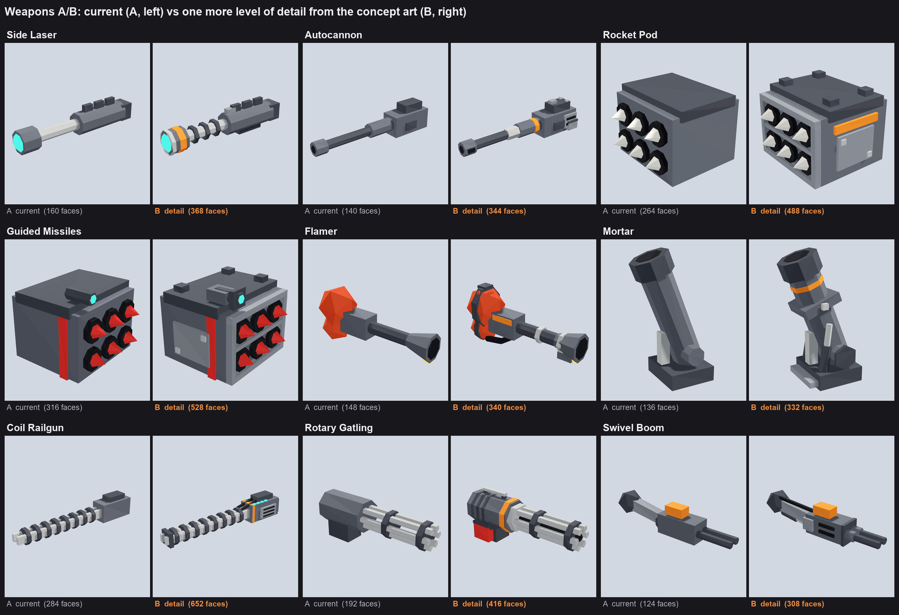
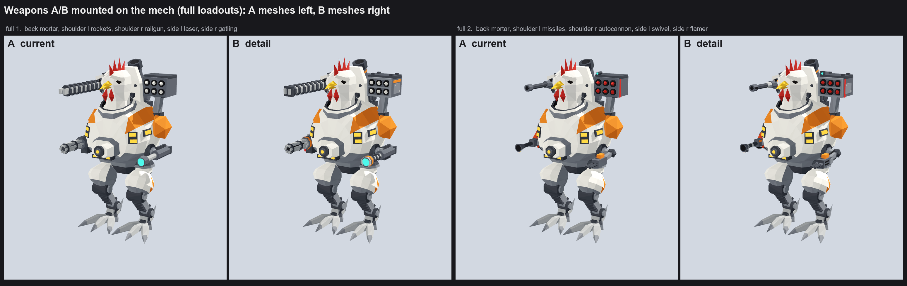

# Weapons A/B: one more level of detail

The user asked: "Let's also a/b one additional level of detail for all the weapons. The concept art has some subtle
details." **A** is each weapon mesh as the game has it (`MechMeshes._weapon`, `assets/models/mech/weapon_*.res`). **B** is
the same weapon with one more level of detail taken from the concept art (`scripts/combat/weapon_detail_meshes.gd`,
`WeaponDetailMeshes`). Nothing in the game changes until a pick is made.

Each cell shows A (left) and B (right) from the same three-quarter camera. One cell per weapon is also saved as
`<id>_ab.png`. To judge scale, `mounted_ab.png` shows two full loadouts on the assembled mech, with A meshes on the left
and B meshes swapped onto the hardpoints on the right:

## What B adds

B starts with a copy of A's primitives, so the origin (mount point), the -Z direction, the size, the muzzle and the
palette all stay the same. It then adds chunky flat-shaded parts: small boxes, 6- to 8-sided short tubes, bands and
slots, nothing thinner than about 2 cm. Faces built in ORANGE go to the "accent" surface, so B takes the player's accent
colour exactly as A does. Glow faces stay sparing: the laser and missile lenses and the flamer pilot light are unchanged,
and the railgun gains four teal charge cells.

| Weapon | A faces | B faces | What B adds | Concept source (`art/renders/mech_r8/`) |
| --- | ---: | ---: | --- | --- |
| Side Laser | 160 | 368 | orange band and steel bezel behind the lens, three heat-sink rings on the emitter, underslung capacitor with cable, front sight block, rear bolts | f_laser (orange ring behind the teal lens, top bracket) |
| Autocannon | 140 | 344 | stepped side armour with cooling slots, top-block bolts and a rear sight, orange breech band, recoil sleeve, muzzle-brake side vents, side ammo box | a_twincannon, c_asym (receiver steps, muzzle) |
| Rocket Pod | 264 | 488 | raised front frame with a row divider, four top lugs, stepped side panels with screws, orange side stripes, rear cable conduit | b_missilebox (top lugs, framed tubes, side panels) |
| Guided Missiles | 316 | 528 | the rockets' frame, lugs, panels and conduit, plus a boxed designator housing with a square lens collar | b_missilebox, c_asym (designator: design language) |
| Flamer | 148 | 340 | tank straps, valve with handwheel, fuel hose to the body, pilot-light shroud, nozzle heat bands, orange body stripe | none specific: design language |
| Mortar | 136 | 332 | square barrel clamp with bolts, side hydraulic pistons, trunnion caps, orange band below the muzzle, base front step | d_mortar (barrel clamp collar, base plate) |
| Coil Railgun | 284 | 652 | seven extra steel coils between the dark ones, muzzle collar, four teal charge cells, side capacitor with slots, cable conduits, orange receiver band, butt plate | g_railgun (tight coil rings, receiver side box, muzzle collar) |
| Rotary Gatling | 192 | 416 | red ammo box with lid and feed chute, rear barrel collar and spindle, three cooling bands, orange front band, carry handle | e_hipgatling (red ammo box, barrel clamp, motor housing) |
| Swivel Boom | 124 | 308 | boom hinge cheeks, hydraulic piston, cable along the boom, vent slots, front face plate, muzzle shrouds | h_booms (boom joints, grooved gun box, dark muzzle face) |

B is between 1.7x and 2.5x A's faces. Its bounds stay within 15% of A's on every axis, and its muzzle end within 5 cm
(`tests/test_weapon_detail.gd`).

**Not reproduced in low poly:** the concept's round screw heads and panel seams (they would need sub-centimetre
geometry or textures), the actual helix of the railgun coil (stacked rings stand in for it), soft cable sag, and the
fine grooves on the swivel gun box (two slots per side read better at game distance).

## Viewing it

- Lab: `.\lab.ps1` then subject **Weapon detail A/B** (`weapon_detail`). Options: `weapon` (each of the nine, or `all`
  for a 3x3 of A|B pairs), `show` (A+B, A only, B only), `view` (`stands` or `mounted`: two mechs, A meshes vs B meshes),
  `loadout` (the two full loadouts). Params: turntable speed (0 = still), gap between stands, labels.
- Re-render these images: `.\tools\weapon_detail\shots.ps1`. It renders on the hidden desktop under the GPU lock
  (`tools/weapon_detail/shots.gd`), then assembles the images with Python + Pillow (`make_ab_grid.py`). Raw shots go to
  `test_logs\weapon_detail\`.

## Adopting B

Picks can be made per weapon. For each weapon picked, the Mech session (which owns `scripts/mech/mech_meshes.gd` and
`assets/models/mech/`) moves its builder body from `WeaponDetailMeshes` into the matching case of `MechMeshes._weapon`
(the rockets/missiles B pod replaces `_tube_pod`). It then regenerates `assets/models/mech/weapon_*.res` with
`tools\models\gen_mech_meshes.ps1`. `tests/test_mech_parts.gd` checks that the saved files match the builders. Gameplay
muzzle points (`MechCatalog.WEAPONS[*].muzzle`) do not move, because B keeps A's muzzle end. After adoption, the weapons
that were picked will show A = B in this review, and the B builders for them can be deleted.

## Outcome (2026-11-22)
The user picked **B for all nine weapons**. The Mech session moved the B builders into `MechMeshes._weapon` and
regenerated `assets/models/mech/weapon_*.res`, so B is now the game's weapon meshes. The A/B builder
(`scripts/combat/weapon_detail_meshes.gd`), the `weapon_detail` lab subject, its test and `tools/weapon_detail/` were
removed afterwards; this folder keeps the comparison images as the record.
